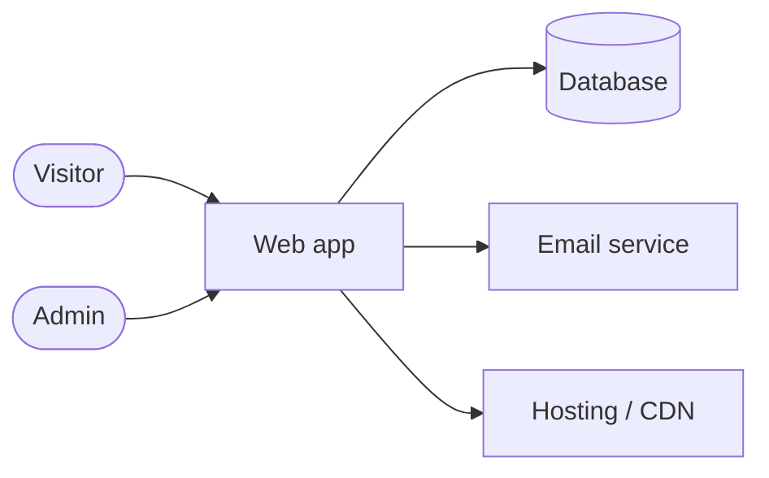
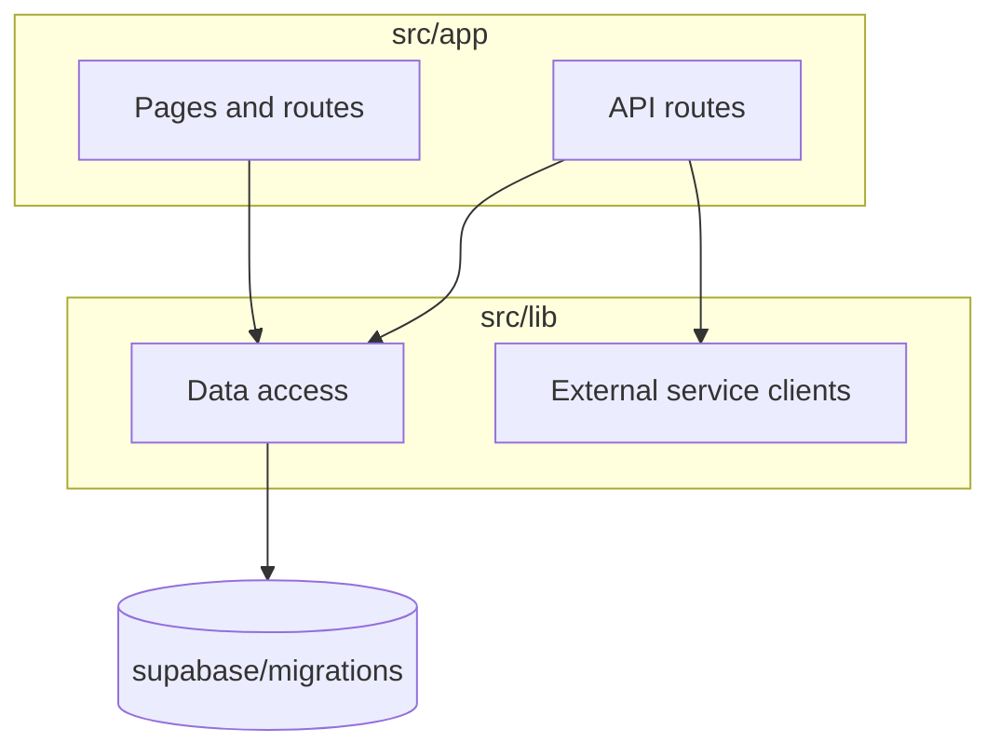

# The seven pages

Seven of arc42's twelve sections earn their place in a project of this size. The others duplicate
existing files or stay empty. The pages are numbered 1 to 7 in reading order; the table names the
arc42 section each stands for.

## Contents

- Page table
- Per page: drift to look for
- Diagrams

## Page table

| Page | File | arc42 section | Source of truth | Updated when |
|---|---|---|---|---|
| Goals | `01-goals.md` | 1 Introduction and goals | links to `docs/BRIEF.md` | `/shape-project` |
| Context and scope | `02-context.md` | 3 Context and scope | external services the code calls, user groups | a new integration |
| Solution strategy | `03-strategy.md` | 4 Solution strategy | the stack preset and the key decisions | `/setup-loop`, then rarely |
| Building blocks | `04-building-blocks.md` | 5 Building block view | the folder tree under `src/` and `supabase/` | a new module or route group |
| Crosscutting concepts | `05-crosscutting.md` | 8 Crosscutting concepts | auth, data access, errors, i18n, a11y, security rules in code | a changed rule |
| Decisions | `06-decisions.md` | 9 Architecture decisions | links into `docs/DECISIONS.md` | every new architecture decision |
| Risks and technical debt | `07-risks.md` | 11 Risks and technical debt | packet follow-ups, open gaps, held items | every milestone |

`docs/architecture/README.md` lists the seven files; keep it in step if a file is renamed.

A project made from an earlier version of the template names the files by their arc42 section
number (`03-context.md`, `04-strategy.md`, `05-building-blocks.md`, `08-crosscutting.md`,
`09-decisions.md`, `11-risks.md`). Find each page by its name and work with the files that are
there: do not rename them here.

## Per page: drift to look for

**Goals**: the brief changed (new audience, new core journey) but the link text or the top
three quality goals still describe the old one.

**Context**: a new external client (a new SDK in `package.json`, a new base URL in env, a new
webhook route) that is not a node in the context diagram; a removed one that still is.

**Strategy**: a decision in the range that changes the stack, hosting, data store or the testing
approach, not reflected here. Link the decision; one sentence of consequence.

**Building blocks**: compare the module map with the tree:

```bash
git ls-files src supabase | cut -d/ -f1-3 | sort -u
```

A folder with code that the map lacks, a block in the map whose folder is gone, a dependency arrow
that the imports contradict.

**Crosscutting concepts**: a rule the code now enforces (an auth check, an error format, a logging
rule, a new lint or CI check) that the page does not name, or a described rule the code no longer
has.

**Decisions**: a new decision in `docs/DECISIONS.md` in the range that affects architecture
(the context, the strategy, a building block or a crosscutting rule) and is not linked. Format,
one line each:

```markdown
- [D-12](../DECISIONS.md#d-12) Data access only through server actions; see Crosscutting concepts.
```

Check that the anchor matches the heading or row ID format `docs/DECISIONS.md` uses.

**Risks**: follow-ups from the milestone packet, items that needed a human, held items, known
gaps; each with impact, likelihood and the item or decision that would close it. Remove risks that
are closed, with the closing PR in the commit message.

## Diagrams

Context:



Building blocks:



Rules: `flowchart` only; one idea per diagram; node labels are the names used in the code; at most
about fifteen nodes, otherwise split by subgraph into a second diagram.
