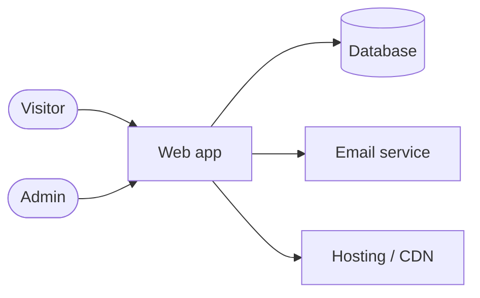
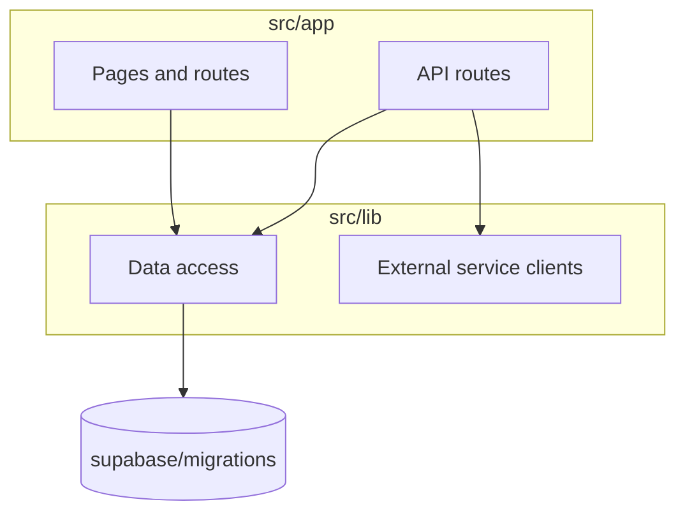

# The seven sections

Seven of arc42's twelve sections earn their place in a project of this size. The others duplicate
existing files or stay empty.

## Contents

- Section table
- Per section: drift to look for
- Diagrams

## Section table

| Section | File | Source of truth | Updated when |
|---|---|---|---|
| 1 Introduction and goals | `01-goals.md` | links to `docs/BRIEF.md` | `/shape-project` |
| 3 Context and scope | `03-context.md` | external services the code calls, user groups | a new integration |
| 4 Solution strategy | `04-strategy.md` | the stack preset and the key decisions | `/setup-loop`, then rarely |
| 5 Building blocks | `05-building-blocks.md` | the folder tree under `src/` and `supabase/` | a new module or route group |
| 8 Crosscutting concepts | `08-crosscutting.md` | auth, data access, errors, i18n, a11y, security rules in code | a changed rule |
| 9 Decisions | `09-decisions.md` | links into `docs/DECISIONS.md` | every new architecture decision |
| 11 Risks and technical debt | `11-risks.md` | packet follow-ups, open gaps, held items | every milestone |

`docs/architecture/README.md` lists the seven files; keep it in step if a file is renamed.

## Per section: drift to look for

**1 Goals**: the brief changed (new audience, new core journey) but the link text or the top
three quality goals still describe the old one.

**3 Context**: a new external client (a new SDK in `package.json`, a new base URL in env, a new
webhook route) that is not a node in the context diagram; a removed one that still is.

**4 Strategy**: a decision in the range that changes the stack, hosting, data store or the testing
approach, not reflected here. Link the decision; one sentence of consequence.

**5 Building blocks**: compare the module map with the tree:

```bash
git ls-files src supabase | cut -d/ -f1-3 | sort -u
```

A folder with code that the map lacks, a block in the map whose folder is gone, a dependency arrow
that the imports contradict.

**8 Crosscutting**: a rule the code now enforces (an auth check, an error format, a logging rule,
a new lint or CI check) that the section does not name, or a described rule the code no longer has.

**9 Decisions**: a new decision in `docs/DECISIONS.md` in the range that affects architecture
(sections 3 to 8) and is not linked. Format, one line each:

```markdown
- [D-12](../DECISIONS.md#d-12) Data access only through server actions; see section 8.
```

Check that the anchor matches the heading or row ID format `docs/DECISIONS.md` uses.

**11 Risks**: follow-ups from the milestone packet, items that needed a human, held items, known
gaps; each with impact, likelihood and the item or decision that would close it. Remove risks that
are closed, with the closing PR in the commit message.

## Diagrams

Context (section 3):



Building blocks (section 5):



Rules: `flowchart` only; one idea per diagram; node labels are the names used in the code; at most
about fifteen nodes, otherwise split by subgraph into a second diagram.
