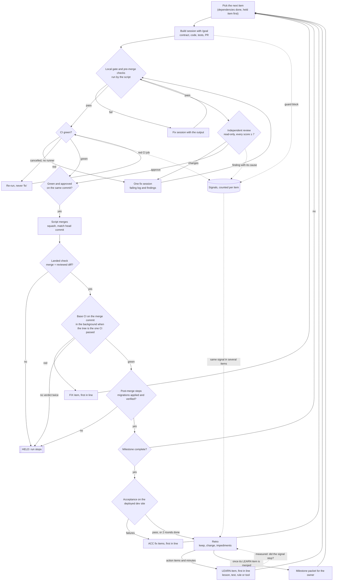
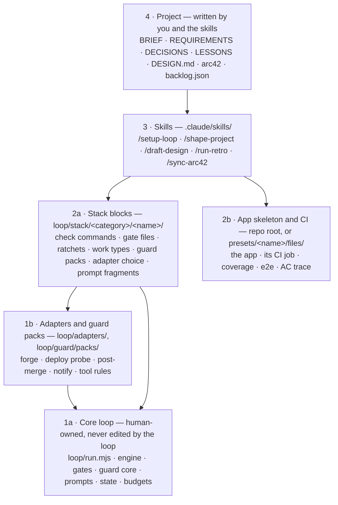

# real-gates

**One agent. A script that decides when it's done. Gates that say no.**

real-gates is a GitHub template for building a whole application with one coding agent, unattended.
The agent builds one backlog item at a time. A script, not the agent, checks the work and merges
it. Nobody reviews the PRs: every safety property comes from a gate the script enforces.

It is the loop from a real run on a tournament website: 49 backlog items in 59 hours, no failed
item, 60 times a gate said no. [WHY.md](WHY.md) tells the story behind each gate.

## The loop



Every box with a question mark is a gate. A gate either passes, sends the item back for a fix, or
holds the run.

The retro is how the loop learns. At the end of every milestone, and early when one signal shows
up in several items, a read-only session says what went well, what went wrong and why. Its action
items become one LEARN item that goes through the same gates, and the next retro checks by the
numbers whether they worked. The loop does not fix its own guard and does not work around it: a
refusal is the guard working and the session goes another way, and a defect in the runner that
broke something is recorded once, without anything waiting for you
([how the loop learns](loop/README.md#how-the-loop-learns-the-retro)).

## Quick start

| Step | You do                                                           | You get                                                                               |
| ---- | ---------------------------------------------------------------- | ------------------------------------------------------------------------------------- |
| 1    | **Use this template** on GitHub, then clone your copy            | A repo with no history                                                                |
| 2    | Not a web app? `node scripts/apply-preset.mjs` lists the stacks  | The project files of that stack ([presets/node-cli](presets/node-cli/README.md))      |
| 3    | `/setup-loop` in Claude Code                                     | `loop/loop.config.json`, guard settings, CI values, branches                          |
| 4    | `/shape-project`                                                 | `docs/BRIEF.md`, `docs/REQUIREMENTS.md`, `loop/backlog.json`, `docs/OWNER-ACTIONS.md` |
| 5    | `/draft-design` (a web app only)                                 | `DESIGN.md` and `design/mocks/accepted/`                                              |
| 6    | `pnpm loop --dry-run`, then `pnpm loop --once`, then `pnpm loop` | The app, merged item by item, with a packet per milestone                             |

You need Node 22 or newer, pnpm, `gh` logged in, and Claude Code logged in. The preflight checks
the versions and tells you what is missing. Details: [loop/README.md](loop/README.md).

During the run the loop keeps `docs/architecture/` true itself: a check fails every PR whose code
the pages do not name. After the app is done, `/run-retro` carries what the run learned and the
impediments it reported back into the template, and `/sync-arc42` fixes prose in the architecture
pages that no check can see.

## Taking a later template version

A project is a copy, so a fix in the template reaches it only when you fetch it:

```sh
node scripts/sync-template.mjs --dry-run   # what would change
node scripts/sync-template.mjs             # do it, then review, commit on a branch, open a PR
```

It updates what is the template's (the loop, the skills, the shared scripts, the CI workflow of
your stack) and never touches what is yours (the config, the backlog, the rules the loop learned,
your docs, the app). Details: [loop/README.md](loop/README.md#taking-a-later-template-version).

## The four layers

Each layer only knows the one below it. Read from the top down. Layers 1 and 2 have two parts
each. The core loop names no framework,
host or database: it reads the stack blocks a project lists, one block per choice (the forge, the
toolchain, the framework, what a user touches, the database, the hosting). A stack that was
proven as a whole has a name, a profile. Two ship with the template: a web app (Next.js,
Supabase, Vercel), which the repository is as it stands, and a Node.js command-line tool, which
`node scripts/apply-preset.mjs node-cli` turns it into. Another tool is another block; layer 1
stays as it is. The contract between them is in [loop/stack/README.md](loop/stack/README.md).



| Layer                | Where                                                                 | Changes                                                                 |
| -------------------- | --------------------------------------------------------------------- | ----------------------------------------------------------------------- |
| 1a · Core loop       | `loop/`                                                               | Never by the loop. A change it wants ships as `loop/patches/<id>.patch` |
| 1b · Adapters, packs | `loop/adapters/`, `loop/guard/packs/`                                 | When a new forge, host or tool is supported                             |
| 2a · Stack blocks    | `loop/stack/<category>/<name>/`, profiles in `loop/profiles/`         | Per tool; a project lists its blocks in `loop/loop.config.json`         |
| 2b · App skeleton    | `src/`, `tests/`, `.github/`, `supabase/`; other stacks in `presets/` | Per stack                                                               |
| 3 · Skills           | `.claude/skills/`                                                     | Rarely. Hidden from the loop (`disable-model-invocation: true`)         |
| 4 · Project          | `docs/`, `DESIGN.md`, `CLAUDE.md`, `loop/backlog.json`                | Every project                                                           |

## Where to watch a run

| What                             | Where                                                |
| -------------------------------- | ---------------------------------------------------- |
| Overview                         | `pnpm loop --status`                                 |
| Live                             | the console, or `.loop/status.json`                  |
| History                          | `.loop/PROGRESS.md`                                  |
| Every session in full            | `.loop/logs/NNN-<item>-<phase>.jsonl`                |
| Blocked actions                  | `.loop/logs/guard.log`                               |
| What the loop learned            | `docs/retros/` (the minutes of every retro)          |
| **Things only you can do**       | `.loop/OWNER-ACTIONS.md`                             |
| Defects in the harness, recorded | `.loop/IMPEDIMENTS.md`                               |
| **Milestone "come look"**        | `.loop/reviews/<milestone>.md`                       |
| Final summary                    | `.loop/REPORT.md`                                    |
| Stop cleanly                     | create `.loop/STOP`                                  |
| Phone                            | set `notify.ntfyTopic` and subscribe in the ntfy app |

## What is in the box

| Path                                  | What                                                                                                                                           |
| ------------------------------------- | ---------------------------------------------------------------------------------------------------------------------------------------------- |
| `loop/`                               | Runner, guard, rule table, prompts, adapters, test suite. [loop/README.md](loop/README.md)                                                     |
| `.claude/skills/`                     | The five skills: `/setup-loop`, `/shape-project`, `/draft-design`, `/run-retro`, `/sync-arc42`                                                 |
| `docs/`                               | Brief, requirements, backlog, decisions, lessons, owner actions, retro minutes, [architecture](docs/architecture/README.md)                    |
| `DESIGN.md`, `design/mocks/accepted/` | The design system and the mocks the reviewer scores against                                                                                    |
| `CLAUDE.md`                           | Project rules every session reads                                                                                                              |
| `examples/sample-backlog/`            | A tiny sample project to read before you shape your own                                                                                        |
| `presets/`                            | Project files of other stacks, swapped in by `scripts/apply-preset.mjs`: [a Node.js command-line tool](presets/node-cli/README.md)             |
| `scripts/`                            | The AC gate, the architecture check, the preset and template-sync scripts, and the scan that keeps emails, keys and names out of a public repo |
| `WHY.md`                              | The incident behind each gate                                                                                                                  |

## The talk

This template comes from the talk **One Agent, Real Gates**: six agents with job titles failed,
one agent with hard gates built the app.
<!-- Link to the slides or recording goes here once it is published. -->

## Licence

MIT. See [LICENSE](LICENSE).
