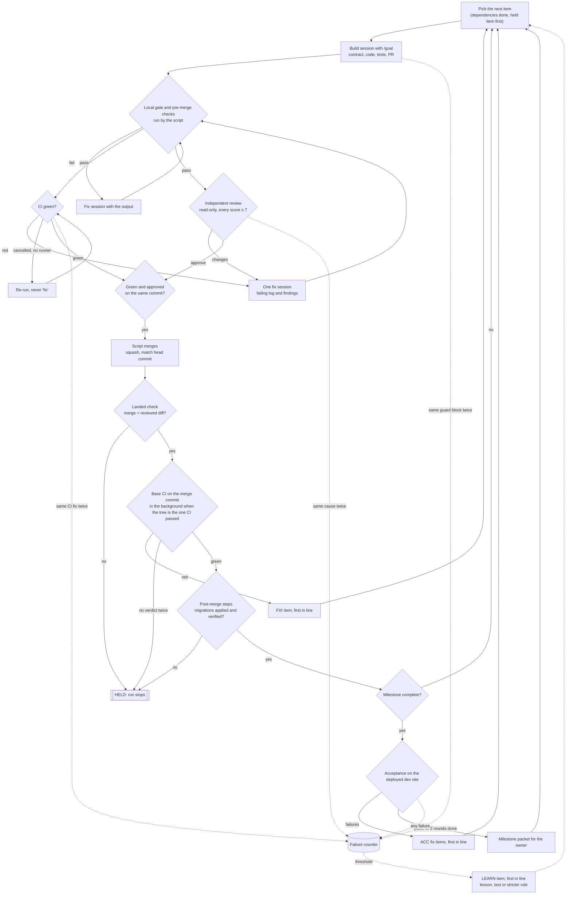
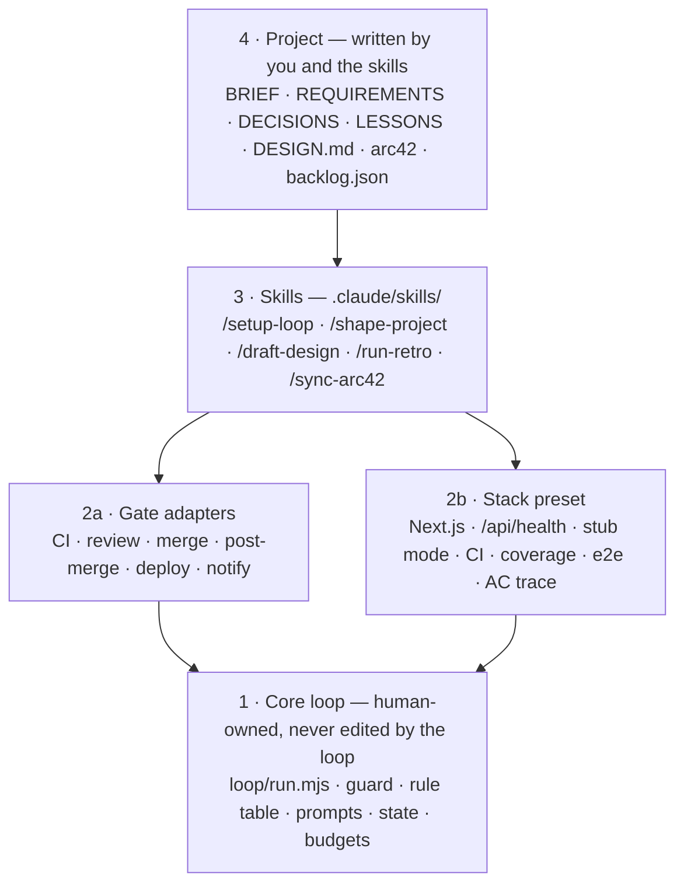

# real-gates

**One agent. A script that decides when it's done. Gates that say no.**

real-gates is a GitHub template for building a whole web app with one coding agent, unattended.
The agent builds one backlog item at a time. A script, not the agent, checks the work and merges
it. Nobody reviews the PRs: every safety property comes from a gate the script enforces.

It is the loop from a real run on a tournament website: 49 backlog items in 59 hours, no failed
item, 60 times a gate said no. [WHY.md](WHY.md) tells the story behind each gate.

## The loop

Every box with a question mark is a gate. A gate either passes, sends the item back for a fix, or
holds the run. The LEARN edge is how the loop learns: a repeated failure becomes an item that
fixes its cause, and that item goes through the same gates.

## Quick start

| Step | You do                                                           | You get                                                                               |
| ---- | ---------------------------------------------------------------- | ------------------------------------------------------------------------------------- |
| 1    | **Use this template** on GitHub, then clone your copy            | A repo with no history                                                                |
| 2    | `/setup-loop` in Claude Code                                     | `loop/loop.config.json`, guard settings, CI values, branches                          |
| 3    | `/shape-project`                                                 | `docs/BRIEF.md`, `docs/REQUIREMENTS.md`, `loop/backlog.json`, `docs/OWNER-ACTIONS.md` |
| 4    | `/draft-design`                                                  | `DESIGN.md` and `design/mocks/accepted/`                                              |
| 5    | `pnpm loop --dry-run`, then `pnpm loop --once`, then `pnpm loop` | The app, merged item by item, with a packet per milestone                             |

You need Node 22 or newer, pnpm, `gh` logged in, and Claude Code logged in. The preflight checks
the versions and tells you what is missing. Details: [loop/README.md](loop/README.md).

After the app is done, `/run-retro` carries what the run learned back into the template, and
`/sync-arc42` keeps `docs/architecture/` true once per milestone.

## The four layers

Each layer only knows the one below it. Read from the top down. To port to another stack, replace
layer 2b only.

| Layer              | Where                                                  | Changes                                                                 |
| ------------------ | ------------------------------------------------------ | ----------------------------------------------------------------------- |
| 1 · Core loop      | `loop/`                                                | Never by the loop. A change it wants ships as `loop/patches/<id>.patch` |
| 2a · Gate adapters | `loop/adapters/`                                       | Per project, through `loop/loop.config.json`                            |
| 2b · Stack preset  | `src/`, `tests/`, `.github/`, `supabase/`              | Per stack                                                               |
| 3 · Skills         | `.claude/skills/`                                      | Rarely. Hidden from the loop (`disable-model-invocation: true`)         |
| 4 · Project        | `docs/`, `DESIGN.md`, `CLAUDE.md`, `loop/backlog.json` | Every project                                                           |

## Where to watch a run

| What                       | Where                                                |
| -------------------------- | ---------------------------------------------------- |
| Overview                   | `pnpm loop --status`                                 |
| Live                       | the console, or `.loop/status.json`                  |
| History                    | `.loop/PROGRESS.md`                                  |
| Every session in full      | `.loop/logs/NNN-<item>-<phase>.jsonl`                |
| Blocked actions            | `.loop/logs/guard.log`                               |
| **Things only you can do** | `.loop/OWNER-ACTIONS.md`                             |
| **Milestone "come look"**  | `.loop/reviews/<milestone>.md`                       |
| Final summary              | `.loop/REPORT.md`                                    |
| Stop cleanly               | create `.loop/STOP`                                  |
| Phone                      | set `notify.ntfyTopic` and subscribe in the ntfy app |

## What is in the box

| Path                                  | What                                                                                                         |
| ------------------------------------- | ------------------------------------------------------------------------------------------------------------ |
| `loop/`                               | Runner, guard, rule table, prompts, adapters, test suite. [loop/README.md](loop/README.md)                   |
| `.claude/skills/`                     | The five setup skills                                                                                        |
| `docs/`                               | Brief, requirements, backlog, decisions, lessons, owner actions, [architecture](docs/architecture/README.md) |
| `DESIGN.md`, `design/mocks/accepted/` | The design system and the mocks the reviewer scores against                                                  |
| `CLAUDE.md`                           | Project rules every session reads                                                                            |
| `examples/sample-backlog/`            | A tiny sample project to read before you shape your own                                                      |
| `scripts/sanitize-scan.mjs`           | Fails when a file carries emails, keys or names that do not belong in a public repo                          |

## The talk

This template comes from the talk **One Agent, Real Gates**: six agents with job titles failed,
one agent with hard gates built the app.
<!-- Link to the slides or recording goes here once it is published. -->

## Licence

MIT. See [LICENSE](LICENSE).
