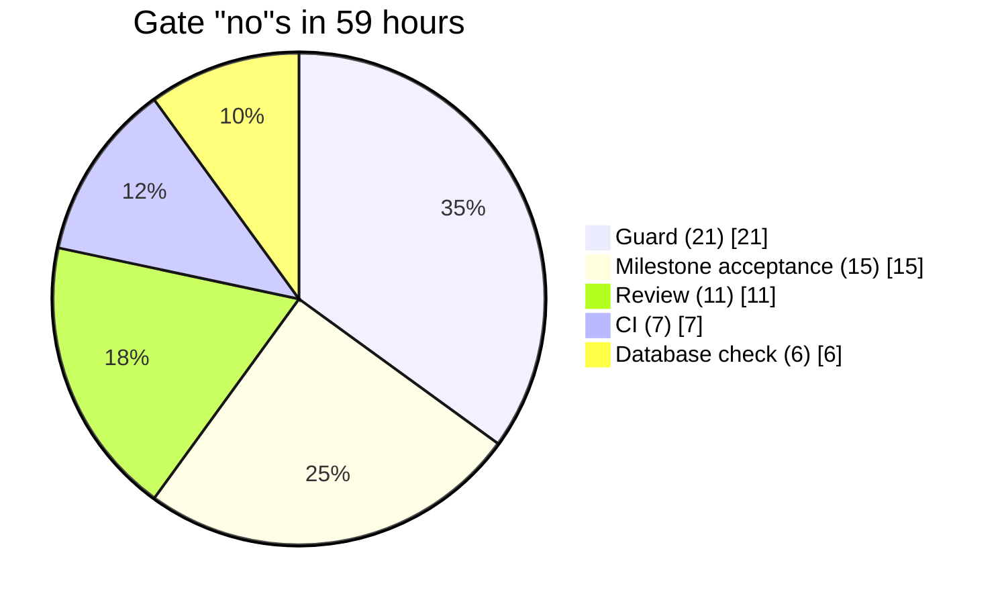

# Why each gate exists

Every gate in this template was paid for once. This page names the incident behind each one.
They all come from the original project (a tournament website), built first by a team of agents
and then by this loop. Names, refs and people are left out on purpose.

## The run in numbers

|                               |                                                         |
| ----------------------------- | ------------------------------------------------------- |
| Backlog items done            | **49** (27 planned, 22 the loop found itself)           |
| Merged PRs                    | 57 (25 of them between 23:00 and 07:00)                 |
| Wall time                     | **59 h**, unattended, nights included                   |
| Items failed                  | **0**                                                   |
| Passed review the first time  | 34 of 49 (**69 %**)                                     |
| Time per item                 | **47 min** on average                                   |
| PR opened → merged            | **14 min** on average                                   |
| Times a gate said no          | **60** (see below)                                      |
| Decisions written unattended  | **57**, read by every later session                     |
| Owner stops                   | **2**: CI billing on GitHub, and the dev site went down |
| Left for the owner at the end | a list of 10 steps, about one hour                      |

### Who said no, 60 times

Each "no" stopped a defect before it landed. That is why no item failed. Only one of six
milestones passed acceptance on the first round.

## Before the loop: six agents, one working tree

The first attempt was a company of six agents with job titles (CEO, CTO, engineers, tester,
designer), all working at the same time in one folder. After 99 work rounds in 25 hours it was
stopped:

- Three agents gave out the same decision number at the same time.
- Two agents told the owner opposite things eleven minutes apart.
- A 293-line change was reported as merged, but never reached the code.
- Seven of eight PRs showed red CI. The tests had never run.

Nobody checked whether anything was actually done. The loop's answer is the first row below.

## Gate → incident

| Gate                                                          | What happened in the original project                                                                                                                                                                                                                                                                | What the gate does now                                                                                                                                                                                                                                                                                                                                                                                                                 |
| ------------------------------------------------------------- | ---------------------------------------------------------------------------------------------------------------------------------------------------------------------------------------------------------------------------------------------------------------------------------------------------- | -------------------------------------------------------------------------------------------------------------------------------------------------------------------------------------------------------------------------------------------------------------------------------------------------------------------------------------------------------------------------------------------------------------------------------------- |
| **Strictly sequential, one lock**                             | Concurrent agents on one working tree collided: duplicate IDs, crossed messages, lost work.                                                                                                                                                                                                          | One loop, one item, one branch at a time. A lock file refuses a second run.                                                                                                                                                                                                                                                                                                                                                            |
| **The script decides done** (`/goal` + re-check)              | Agents said "done" for work that was not there.                                                                                                                                                                                                                                                      | Done means: `result.json` exists, a PR exists, CI is green, an independent reviewer approved. Code checks every point.                                                                                                                                                                                                                                                                                                                 |
| **Landed check** (patch-id)                                   | A change was reported as merged and never landed.                                                                                                                                                                                                                                                    | After the merge the script fetches, checks the merge commit is on base, and that its patch equals the reviewed diff. Mismatch → held.                                                                                                                                                                                                                                                                                                  |
| **Base must be an ancestor** (L-01)                           | Two PRs were green on their own and merged cleanly as text. Together the typecheck was red: one renamed a function the other still called.                                                                                                                                                           | Before merging, the PR branch must contain the current base. If base moved, the branch is updated and CI runs again. The merge uses `--match-head-commit`.                                                                                                                                                                                                                                                                             |
| **Cancelled with no runner = re-run** (L-02)                  | Seven of eight open PRs and base itself showed red CI. Every failing job was `cancelled` with no runner. After a re-run, all were green.                                                                                                                                                             | The script reads the jobs. `cancelled` with an empty runner is re-run, never handed to a fix session.                                                                                                                                                                                                                                                                                                                                  |
| **A CI timeout is not a pass**                                | GitHub billing stalled and CI did not run for an evening. Only the owner could fix it.                                                                                                                                                                                                               | No CI result within the timeout → one re-run, then the item is held. Never merged on a guess.                                                                                                                                                                                                                                                                                                                                          |
| **Gap check** (L-03)                                          | One migration apply was cancelled and queued for the owner. A later migration that wrote to its table was applied on top. A feature on dev failed with "relation does not exist" until the owner applied the gap by hand.                                                                            | Post-merge applies every missing migration, oldest first, and never a file while an earlier one is missing.                                                                                                                                                                                                                                                                                                                            |
| **Hold gate** (unverified post-merge)                         | An item's migration apply was cancelled, but the item was marked done anyway. The next item merged code that read a column only the unapplied file adds. Every public page on dev failed.                                                                                                            | An item whose post-merge step is not verified is **held**, not done. The run stops. A resumed run takes the held item first and verifies again.                                                                                                                                                                                                                                                                                        |
| **No approval prompts, and the script applies migrations**    | The unattended applies above were cancelled by an approval prompt that nobody was there to answer.                                                                                                                                                                                                   | Every session runs with `--permission-prompts none`: a prompt is denied at once and not retried. Migrations are applied by the script through the Supabase CLI, not by an agent through a tool that asks.                                                                                                                                                                                                                              |
| **Read-only steps have no write tools**                       | 12 of the 21 guard blocks were a reviewer trying to write, although it may only read.                                                                                                                                                                                                                | Review, acceptance and packet sessions start without Edit, Write, MultiEdit and NotebookEdit. Their verdict comes back as structured output. The guard stays as the backstop.                                                                                                                                                                                                                                                          |
| **SQL is judged without comments**                            | A migration was refused because the word "public." in a SQL comment matched a schema rule. Dev never got a status trigger and accepted any status change; acceptance caught it.                                                                                                                      | The SQL guard removes comments the way Postgres reads them first. A comment can no longer trip a rule, and it cannot hide a write either.                                                                                                                                                                                                                                                                                              |
| **Every rule has an allow and a block example**               | The comment false-positive above: a rule can block what it should allow, and nothing noticed until acceptance.                                                                                                                                                                                       | Each project rule carries one example it must block and one it must allow. CI checks both.                                                                                                                                                                                                                                                                                                                                             |
| **Rules only tighten**                                        | An acceptance fix item found that a SQL tool call could slip past the guard, and tightened it. Good, but the same power could loosen it.                                                                                                                                                             | `loop/rules/project-rules.json` may only grow. CI fails any PR that removes or changes a rule from base.                                                                                                                                                                                                                                                                                                                               |
| **The loop fixes its own causes** (LEARN, ACC items)          | Acceptance failures became fix items, and those fixed the cause, not only the symptom: one wrote the gap-check lesson and a prompt test, the next built the hold gate with its tests.                                                                                                                | Failures are counted by signal. A retro turns them into a few action items; one LEARN item carries them out through the same gates.                                                                                                                                                                                                                                                                                                    |
| **Retros: measured action items, impediments, what to keep**  | One run spent half its money on LEARN items about the guard. Each refusal of a harmless command counted, the second one queued an item, the item could only teach sessions to phrase around the guard, and its own review findings queued the next. Five lessons were workarounds for one guard bug. | A retro at the end of every milestone, and early when a signal shows up in several different items. It says what went well, hands out at most three action items, and checks the earlier ones by the numbers: one that did not help is revised or taken back. A cause in the harness is reported to the owner as an impediment, never worked around. A LEARN item's own failures do not count, and acceptance judges the product only. |
| **The loop never edits its runner**                           | The hold gate above was written by the loop, but wiring it into the runner was the owner's edit, between runs.                                                                                                                                                                                       | `loop/**` is a protected path. A runner change ships as `loop/patches/<id>.patch`; the run continues without it, and `/run-retro` applies it later.                                                                                                                                                                                                                                                                                    |
| **Isolation** (`--setting-sources project,local`, strict MCP) | One build session loaded the owner's 10 personal plugins, 360 skills and mail and drive connectors. On another machine the loop would behave differently.                                                                                                                                            | Sessions load only the repo's settings and MCP servers. The preflight reads the session's init event and stops if anything foreign shows up.                                                                                                                                                                                                                                                                                           |
| **Smoke test at every start, no `--bare`**                    | Design call, no incident: bare mode skips hooks, so the guard would stop without a sound.                                                                                                                                                                                                            | Each run starts with a session told to run a forbidden command. The run continues only if the guard log shows it blocked.                                                                                                                                                                                                                                                                                                              |
| **No auto memory**                                            | Design call, no incident: machine-local memory is never committed and would steer later runs invisibly.                                                                                                                                                                                              | Generated settings set `autoMemoryEnabled: false`. Everything the loop learns goes into committed files.                                                                                                                                                                                                                                                                                                                               |
| **Independent reviewer that drives the app**                  | The reviewer found a script injection by trying it: the injected code ran. Fixed and re-tested in the next round. It also caught a sign-up page that was three times too large.                                                                                                                      | A fresh, read-only session checks the contract, runs the branch and scores design quality, originality, craft and functionality. Any score below 7 blocks a UI item.                                                                                                                                                                                                                                                                   |
| **Milestone acceptance on the deployed site**                 | The dev site was broken although every test was green. Acceptance noticed, and fixes went first in line.                                                                                                                                                                                             | Per milestone, a session tests every journey on the real dev site, after `/api/health` reports the merged commit and a working database. Failures become ACC items, max two rounds.                                                                                                                                                                                                                                                    |
| **One place for owner actions**                               | The loop wrote a list of everything only the owner could do: 10 steps with exact clicks and values. The agent never had to guess.                                                                                                                                                                    | Owner asks go to `.loop/OWNER-ACTIONS.md`, setup ones to `docs/OWNER-ACTIONS.md`.                                                                                                                                                                                                                                                                                                                                                      |
| **Budgets and a dollar cap**                                  | The original capped sessions and hours. The dollar cap is a design call: it also stops one session that runs away.                                                                                                                                                                                   | 150 sessions or 120 h per run, per-item round limits, a circuit breaker after 3 items with no merge, and `--max-budget-usd` per session.                                                                                                                                                                                                                                                                                               |

## Three things to copy, even without this template

1. **Make "done" checkable.** Code checks it, not the agent.
2. **Separate building from checking.** A fresh reviewer with a clear contract, testing the real app.
3. **Give the agent one place to write what only you can do.** Then it never has to guess.
