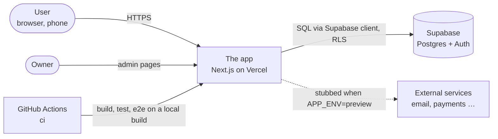

# 3 · Context and scope

<!-- Update in the same PR as a new integration. One box per external system, one arrow per
     direction of data. -->

| Neighbour                    | What crosses the boundary                     | Owner of the account |
| ---------------------------- | --------------------------------------------- | -------------------- |
| Supabase                     | Data, auth sessions                           | Owner                |
| Vercel                       | Deploys from the base and production branches | Owner                |
| <!-- e.g. email provider --> |                                               |                      |

## Out of scope

<!-- Systems people might expect us to integrate with, and why we don't. -->
