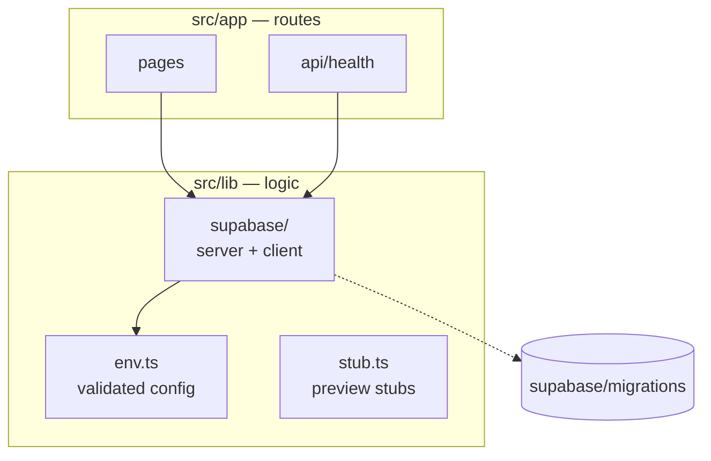

# 5 · Building blocks

<!-- The module map. Start from the folder tree (`git ls-files src | cut -d/ -f1-3 | sort -u`),
     then check it by hand. A new module or route group updates this page in the same PR. -->

| Block              | Path                  | Responsibility                            | Depends on         |
| ------------------ | --------------------- | ----------------------------------------- | ------------------ |
| Health             | `src/app/api/health/` | Reports `{ commit, db }` for acceptance   | `src/lib/supabase` |
| Config             | `src/lib/env.ts`      | Reads and validates environment variables | —                  |
| Data access        | `src/lib/supabase/`   | Server and browser clients                | Config             |
| Stubs              | `src/lib/stub.ts`     | Fakes external services in preview and CI | Config             |
| <!-- new block --> |                       |                                           |                    |
