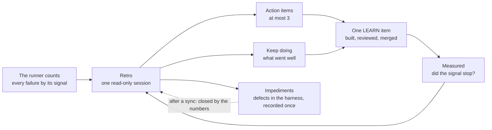

# The loop

Builds the backlog unattended, one item at a time. Each step runs in a fresh headless Claude Code
session. **The script decides when something is done, not the agent.**

```
pick next item (backlog order, dependencies done; held, FIX, ACC and LEARN items first)
 └─ build session (/goal)  → contract first (docs/contracts/<id>.md: every AC + its proof),
                             then branch, code, tests, PR to the base branch, .loop/result.json
 └─ local gate             → the script runs `localGate.commands` on the pushed head.
                             Failing? fix session with the output, before any CI wait
 └─ pre-merge checks       → base is an ancestor (L-01), no edited migrations, no protected or
                             runtime files, coverage thresholds did not drop, the contract names
                             every AC of the item. They need neither CI nor a reviewer, so they
                             come first
 └─ CI and review together → the script waits for CI while the review session runs on the same
                             head (`review.parallelWithCi`). Red CI and review findings go into
                             one fix round. Cancelled with no runner? re-run, never a fix (L-02)
    review session         → independent, read-only: contract, hard rules, drives the app,
                             scores design quality / originality / craft / functionality 1–10;
                             any score < 7 blocks a UI item. Changes? fix session (max 2 rounds).
                             The merge needs CI green **and** the approval, on one commit
 └─ script merges          → squash, --match-head-commit, into the base branch only
 └─ landed check           → merge commit is on origin/<base> and its patch-id equals the
                             reviewed diff. No? HELD
 └─ base CI                → on the merge commit. Red? a FIX item goes first in line.
                             No result? one re-run, then the run stops (a timeout is not a pass).
                             When the landed check proved the merge commit has exactly the tree
                             PR CI passed on, the next item starts meanwhile (`baseCiWait`)
 └─ post-merge steps       → the script applies new migrations with the Supabase CLI and checks
                             the migration list. Not verified? HELD, and the run stops
 └─ milestone complete?    → acceptance where the product runs: on the deployed dev site, after
                             /api/health reports the merged commit and db ok, or on the merged
                             base itself when nothing is deployed. Failures become ACC items,
                             max 2 rounds
                           → retro: what went well, what went wrong and why. Its action
                             items become one LEARN item, built before the packet; causes in
                             the harness are recorded as impediments; nothing waits
                           → review packet in .loop/reviews/<milestone>.md, once those items
                             are settled. Fixes from the last round are not re-accepted: the
                             packet and OWNER-ACTIONS say so
```

Why each step is there: [../WHY.md](../WHY.md). It is deliberately **sequential**: concurrent
agents sharing one working tree are what broke the setup this loop replaced.

## Core, stack, project

The loop is three things, kept apart:

| | Where | Knows |
| --- | --- | --- |
| **Core** | `loop/run.mjs`, `loop/lib/`, `loop/guard/core.mjs`, `loop/prompts/` | The method: the item engine, the gates, git, the read-only steps. No framework, host or database |
| **Stack blocks** | `loop/stack/<category>/<name>/`, listed by `stack` in the project config or by the profile it names | What the project is built with, one block per choice: the forge, the toolchain, the framework, what a user touches, the database, the hosting. Each block adds its check commands, gate files, ratchets, work types, guard packs and adapters, and its words for each step |
| **Project config** | `loop/loop.config.json` | Which blocks, and this project's own values: repo, branches, the dev URL, the git author |

Behind the blocks' choices sit **adapters** (`loop/adapters/`: the forge, the deploy probe, the
post-merge steps, notifications) and **guard packs** (`loop/guard/packs/`: the rules for one tool
or service). The core only calls their interfaces. Another tool is another block; another forge or
host is another adapter. The contract: [stack/README.md](stack/README.md).
`node loop/scripts/stack.mjs` prints this project's blocks and what they add up to, and
`node scripts/build-stack.mjs --stack …` builds a project from a list of blocks that is not a
profile.

A block is **proven** (a real project was built with it) or a **draft** (tested, and no project
has run on it yet); the run says before it starts when its stack uses a draft. A **profile**
(`loop/profiles/<name>/`) is a stack that was proven as a whole: a named list of proven blocks. Two ship: `next-supabase-vercel` (the repository as it stands) and `node-cli`
(`node scripts/apply-preset.mjs node-cli`). This page describes the web preset where it has to
name a tool; where the two differ, the blocks decide:

| | Web app | Node CLI |
| --- | --- | --- |
| Local gate | `pnpm check` | `npm run check` |
| Work types | `ui` (four design scores), `default` | `command` (help and errors, ergonomics, output, robustness), `default` |
| Milestone acceptance | on the deployed dev site (the web UI block on a stack that deploys nothing: on a build of the merged base, started locally) | on the merged base: packed, installed under `.loop/`, used from there |
| Post-merge steps | migrations to the dev database | none |
| Guard packs | `github`, `supabase`, `vercel` | `github`, `npm` |
| Ratchet | coverage thresholds in the Vitest config | `coverage.thresholds.json` |

## Prerequisites (once)

`/setup-loop` checks and writes all of this. By hand:

1. **Node ≥ 22** and **pnpm**. The runner and guard use Node built-ins only, so they work before
   `pnpm install`.
2. **Claude Code**, logged in (`claude` → `/login`). The preflight checks the minimum version. Do
   not set `ANTHROPIC_API_KEY`; the loop removes it from its sessions unless `allowApiKey` is set.
3. **gh** logged in with access to the repo (`gh auth status`).
4. `loop/loop.config.json` filled: repo, branches, dev URL, the one allowed database project, git
   author. `node loop/run.mjs --dry-run` names everything still missing.
5. `DEV_DB_URL` (the dev database URL) in the environment that runs the loop, for the post-merge
   step. Without it, a merge with migrations is held and the step goes to `.loop/OWNER-ACTIONS.md`.
   Only the runner uses it: agent sessions start without it (see [Session environment](#session-environment)).
6. **Branch protection on the base branch**: require a pull request and the CI check, no required
   approvals, no direct or force pushes. The preflight asks GitHub and refuses to start without a
   protection rule or ruleset. If your plan does not offer one for this repository, set
   `guard.requireBranchProtection` to `false`.
7. `pnpm install` and `pnpm exec playwright install chromium`.
8. Keep the machine awake while it runs.

## Run

```sh
git checkout <base>
pnpm loop --dry-run      # preflight, shows the next item, starts no sessions
pnpm loop --once         # one item end to end: watch the first PR go through
pnpm loop                # everything
```

`pnpm loop` is `node loop/run.mjs`. Every run starts with a **smoke test**: one session is told
to run `git add -A --dry-run`, a harmless command the guard refuses. The run continues only if
`.loop/logs/guard.log` shows it blocked, and only if the session's init event lists nothing foreign (plugins, MCP servers or skills
from outside the repo, auto memory).

| Flag | Does |
| --- | --- |
| `--dry-run` | Preflight and the next item. No sessions |
| `--once` | One item, then stop |
| `--item <ID>` | Only this item |
| `--only <milestone>` | Only items of this milestone |
| `--max-iterations <N>` | Stop after N sessions |
| `--max-hours <H>` | Stop after H hours |
| `--status` | Print the state of every item, held items marked **HELD** |
| `--reset <ID>` | Set an item back to todo, and remove its [working folders](#working-folders) |
| `--skip <ID>` | Mark an item skipped, and remove its working folders |
| `--release <ID>` | Release a held item you fixed by hand (see [Holds](#holds)) |

It resumes where it stopped: all state is in `.loop/state.json`. Run it again after a crash or a
reboot and it continues, including an item that was mid-CI or mid-review.

## Watch, stop, review

| What | Where |
| --- | --- |
| Overview | `pnpm loop --status` |
| Live | the console, or `.loop/status.json` |
| History | `.loop/PROGRESS.md` |
| Every session in full | `.loop/logs/NNN-<item>-<phase>.jsonl` |
| Blocked actions | `.loop/logs/guard.log` (time, item, phase, rule, reason, what was refused) |
| What the loop learned | `.loop/retros/R-<n>.md` (the minutes of each retro), filed in `docs/retros/` |
| Defects in the harness the run recorded | `.loop/IMPEDIMENTS.md` (a record; nothing in the run waits for it) |
| Time and cost per session | `.loop/ledger.jsonl` (item, phase, whether it ended ok, turns, duration, cost) |
| What happened, for a program | `.loop/events.jsonl` (one JSON line per event, see below) |
| **Things only you can do** | `.loop/OWNER-ACTIONS.md` |
| **Milestone "come look"** | `.loop/reviews/<milestone>.md`, with screenshots |
| Final summary | `.loop/REPORT.md` |
| Stop cleanly (finishes the current step) | create `.loop/STOP` (any content); delete it to run again |
| Phone notifications | set `notify.ntfyTopic`, subscribe in the ntfy app |

### Working folders

A session may write freely under `.loop/`, and a read-only step nowhere else. So every session
gets a folder of its own there, named in its prompt, for what it writes for itself: notes, a PR
body, probe scripts, sample data, a temporary worktree, an installed package. The runner creates
the folder before the session and removes it when what the step worked on is finished:

| Folder | Whose | Empty at the start of | Removed |
| --- | --- | --- | --- |
| `.loop/work/<item>/build/` | the build sessions of an item | the first one only: a fix round finds what the round before left | when the item is done |
| `.loop/work/<item>/review/` | its review sessions | every review session | when the item is done |
| `.loop/work/<milestone>/accept/` | acceptance: what it installs, its scratch folders | every acceptance round | when the milestone is packed |
| `.loop/work/<milestone>/packet/` | the packet session | the session | when the milestone is packed |
| `.loop/work/<retro>/retro/` | the retro session | the session | when the retro is over |

An item that ends blocked, failed or `needs_human` keeps its folders, so you can see what its
sessions were doing; `--reset <ID>` and `--skip <ID>` remove them. At every start the runner
also removes what a killed run left of items and milestones that are finished.

Everything else under `.loop/` is kept for the whole run: the runner's own files (the table
above), and the evidence a prompt asks for by name, `.loop/shots/<item>/` and
`.loop/reviews/<milestone>/`. The folder is a convention the prompts set, not a gate: the guard
does not refuse a file a session writes elsewhere under `.loop/`, and the runner never deletes
a file it did not name itself. A project that was already running before its template had
working folders keeps what its sessions left there; delete that by hand while no loop runs.

### The event file

`.loop/PROGRESS.md` is written for a person. `.loop/events.jsonl` says the same things as one JSON object
per line, so a script can count them without reading sentences. Every line has `v` (the format
version, now `1`), `at` (ISO time) and `type`. Within a version fields are only added, never renamed
or removed. A dry run writes nothing.

| `type` | Fields | Written when |
| --- | --- | --- |
| `run.started` | `items` | a run begins |
| `run.ended` | `reason`, `sessions` | a run ends in order |
| `run.stopped` | `why` | the runner stops itself and writes `.loop/STOP` |
| `run.crashed` | `error` | the runner ends on an error |
| `build.round` | `item`, `round`, `outcome`, `pr` | a build session ends (`outcome` is `no-result` when it left no result) |
| `check.sent_back` | `item`, `check`, `pr`, `round`, `detail` | a check sends the PR back to a build session; `check` is `local-gate`, `pre-merge`, `ci` (with `jobs`), `review` or `merge` |
| `review.verdict` | `item`, `pr`, `round`, `verdict`, `blocking` (`category`, `file`) | a review session returns |
| `item.merged` | `item`, `pr`, `sha` | the script merged the PR |
| `item.held` | `item`, `kind`, `why` | an item waits for the owner |
| `item.released` | `item`, `kind` | the owner released a held item |
| `item.finished` | `item`, `milestone`, `status`, `why`, `buildRounds` | an item reaches its final status |
| `base.red` | `item`, `sha`, `background`, `fix` | CI on the base branch failed after a merge |
| `base.no_verdict` | `item`, `sha`, `why` | CI on the base branch never reported |
| `postmerge.step` | `item`, `adapter`, `ok`, `note` | a post-merge step ran |
| `acceptance.round` | `milestone`, `round`, `mode`, `places`, `pass`, `failures` | a milestone acceptance session returns. `places`: where it was accepted, `site`, `local` or both; `mode` is the first of them |
| `milestone.packed` | `milestone`, `unverified` | a milestone is closed |
| `retro.called` | `item`, `signature` | a signal showed up in enough different items to call a retro early |
| `retro.held` | `retro`, `kind` (`milestone` or `early`), `milestone`, `wentWell`, `problems`, `actions`, `impediments`, `learn` | a retro session returned |
| `learn.queued` | `learn`, `retro` (`item` and `signature` are always null now) | a retro queued its LEARN item |
| `action.checked` | `action`, `retro`, `verdict`, `decision`, `itemsSince`, `hits` | a retro judged an earlier action item |
| `impediment.reported` | `impediment`, `retro`, `part`, `signal`, `title` | a retro recorded a defect in the harness |
| `impediment.seen` | `impediment`, `retro`, `seen` | a retro met a recorded one again: its count went up |
| `followup.queued` | `item`, `followup`, `milestone` | a build session raised a follow-up item |
| `usage.wait` | `item`, `minutes` | the usage limit was hit and the run waits |

Sessions with their time and cost stay in `.loop/ledger.jsonl`; the two files join on `item`.

The loop never pauses at a milestone. Read each packet when it arrives; change the plan between
runs.

## Guardrails

**The guard** (`loop/guard.mjs`) is a fail-closed PreToolUse hook on every loop session: if it
cannot run, the action is refused. The runner starts sessions with a copy of the guard from the
base branch, so a change in the working tree cannot switch a rule off. Its locked
core (`loop/guard/core.mjs`) holds the git, file and read-only rules. The rules for a tool or
service are in guard packs (`loop/guard/packs/`), switched on by `guard.packs` of the stack's blocks
(the web preset: `github`, `supabase`, `vercel`; the CLI preset: `github`, `npm`). A pack can only block, an unknown pack name refuses
every call, and the packs are part of the snapshot. Together they block:

| Area | Blocked |
| --- | --- |
| Git | push to base or production, force-push, commits on base, `git add -A`, history-destroying commands |
| Merging | `gh pr merge` (only the script merges), repo settings, secrets, branch protection, `gh api` writes |
| Database | any Supabase project except `guard.allowedDbProject`, every ref in `guard.forbiddenRefs`, `apply_migration`, `supabase db push` / `reset`, writing or destructive SQL from a session |
| SQL | judged with comments removed, the way Postgres reads it, so a comment can neither trip a rule nor hide a write |
| Files | `loop/**` and the other `guard.protectedPaths`, `.env*`, migrations already on base (in the folder of a post-merge step, or one `migrations.dirs` names), broad deletes |
| Read-only steps | review, accept, packet and retro: any write outside `.loop/`, any git write. These sessions also start without write tools |
| Hosting | Vercel settings writes |

**Where a read-only step may write.** A review, acceptance, packet or retro session keeps its evidence
under `.loop/`. A redirect (`>`, `>>`, `2>`, `&>`) or a `tee` passes when its target is there:

| The line | Passes? | Why |
| --- | --- | --- |
| `pnpm test >> .loop/reviews/t.txt 2>&1` | yes | the target is spelled out under `.loop/` |
| `cd .loop/work/E1-1/review/wt && pnpm test > out.txt` | yes | `&&` makes it certain where `out.txt` lands |
| `pnpm test > out.txt`, in a session whose folder is `.loop/work/E1-1/review/wt` | yes | the guard knows the session's folder |
| `grep '>>' docs/a.md`, `node -e "[1].map(x => x)"` | yes | a `>` inside quotes is text |
| `cd .loop/work/E1-1/review/wt; pnpm test > out.txt` | no | after `;` or a new line the `cd` may have failed |
| `pnpm test > $OUT/t.txt`, `echo x > .loop/../src/a` | no | the target cannot be read, or does not stay under `.loop/` |
| `echo 'echo x > src/a' \| bash` | no | text that a shell on the line runs is not text |

On a line that is not plain shell (a backslash, a backtick, `$( … )`, a comment) the guard reads
every `>` as a redirect and accepts only a target spelled out as the null device, a temp folder
or a path through `.loop/`. What a program writes by itself (`node -e`, a script, `cp`) no command
pattern can see: the check after the session, below, covers tracked files.

**After every session** the runner checks what no command pattern can be trusted to catch. The
first two stop the run (`.loop/STOP`, with an entry in `.loop/OWNER-ACTIONS.md`) when they fail;
the third counts a guard violation and lets the run go on:

| Check | Why |
| --- | --- |
| The guard snapshot and the session settings are byte-for-byte unchanged | a session that edits them would switch the guard off for every later one. Both are rebuilt from the base branch before every session |
| `origin/<base>` and `origin/<production>` did not move | only the runner's own merge moves the base. A push or merge by a session, in whatever spelling, shows up here |
| A read-only session left the tree clean | otherwise the change is counted as a guard violation and kept aside as a stash |

A PR found already merged before the runner merged it is **held** (`outside-merge`) until you
release it; the item is then rebuilt through the gates. Branch protection on the base branch that
requires the CI check stops such a merge at GitHub as well. The preflight checks that the base
branch has one and refuses to start without it.

### Session environment

An agent session does not get the runner's secrets. Removed from every session: each
`postMerge[].dbUrlEnv` (the dev database URL) and every name in `sessionEnvDeny`. The deploy
bypass secret (`deploy.bypassSecretEnv`) reaches only the acceptance and packet steps, which open
the deployed site. The guard's SQL rules cover the database tool; they cannot see a shell command
that connects on its own, so the URL must not be there to use. List any other variable only the
runner or you need in `sessionEnvDeny`. Keep such values out of files a session can read, too.

### The contract and the AC gate

The build session writes `docs/contracts/<item>.md`. The pre-merge check refuses the PR unless
that file names every AC ID the item names (in `refs`, `title` or `scope`). In CI,
`scripts/ac-trace.mjs` then requires each AC a contract names to be in the title of a test that
runs: `skip`, `todo`, `fixme` and expected-to-fail tests do not count. ACs of items not built
yet are listed as pending. `pnpm ac-trace --all` checks every AC, for a release.

### Evidence, not titles

In CI the AC gate reads the JUnit reports the test steps write to `artifacts/junit/`
(`pnpm ac-trace --results artifacts/junit`). An AC a contract names must be named by a test case
that **ran and passed**. A test inside a skipped group, a conditional skip or a file the runner
never collected has a title and no passing case, so it does not count. A missing report fails the
check. Any test runner that writes JUnit can feed it.

### The architecture pages

`docs/architecture/` is kept true by the PR that changes the code, with nobody running a skill:

- The build prompt says which page a change touches: the building-blocks page for a new module,
  the context diagram for a new external service, the risks page for a gap left behind.
- `node scripts/arch-check.mjs` runs in the local gate and in CI. A failure goes to a fix session
  like any other red check.
- The reviewer judges what a script cannot: whether what a page says is right.

| The check fails when | So that |
| --- | --- |
| a building block in the code is not named on the building-blocks page | a new module cannot merge undocumented |
| the page names a path that is not in the repository | a removed or renamed module leaves the page too |
| a page names a decision ID `docs/DECISIONS.md` does not have | no page cites a decision nobody recorded |
| a relative link on a page leads to no file | the pages stay readable |

What a building block is comes from `architecture.blocks` of the stack's blocks: `src/lib/*` is
every file and folder in `src/lib`, `src/*/` every folder in `src`. A block counts as named when
the page has its path, or a path inside it, in backticks. Test files, type declarations and
dotfiles are not blocks. The patterns are in `loop/`, which no loop session can edit, so the loop
cannot shrink the check to get past it; to make it finer or coarser for your project, set
`architecture.blocks` in `loop/loop.config.json`.

`/sync-arc42` stays for you: it reads a whole milestone's diff and fixes prose that drifted,
which no script sees. The loop does not need it to keep going.

### Base CI in the background

`baseCiWait: "unless-tree-equal"` (the default): the landed check compares the merge commit's tree
with the reviewed head. When they are identical, PR CI already passed on exactly that tree, so the
next item starts while base CI runs. Nothing is waived: the runner looks at every pending commit
before each item, a red result queues its FIX item first in line, and a commit without a verdict
(after one re-run) stops the run with an owner action. Before a milestone is accepted and before a
run reports its result, the runner waits for every pending verdict. `"always"` waits after every
merge.

### A red base and the post-merge steps

`postMergeOnRedBase: "apply"` (the default) runs the post-merge steps even when base CI is red
after a merge. That is deliberate: the host deploys the base branch whether CI is green or not, and
merged code without its migration is the outage the hold gate exists for. `"wait"` is for steps
that must never act on a red base (a release, a publish): the item stays open, its FIX item runs
first, and the steps run once that item is done. If the FIX item does not finish, the item is held.

### The local gate

`localGate.commands` (the preset: `pnpm check`, then `node scripts/arch-check.mjs`) are run by
the runner on the pushed branch head
after each build session, with the same reduced environment as a session. A failure goes straight
to a fix session with the output in `.loop/logs/gate-<item>-r<round>.txt` and counts against the
CI fix rounds. It does not replace CI: CI still decides the merge. Set `commands` to `[]` to
switch it off.

**Pre-merge, the runner also refuses** changes to CI's wiring: the `scripts` in `package.json`,
`scripts/`, the lint, test, type and format configs, and any Vitest config change other than
raised threshold numbers. A PR that could switch a gate off must not be able to pass it.

**Session flags.** Every session runs with `--setting-sources project,local`,
`--strict-mcp-config` (plus the repo's `.mcp.json` if there is one), `--permission-mode auto`,
`--permission-prompts none` and `--max-budget-usd`. Never `--bare`, because it skips hooks. Never
bypass permissions. Generated settings turn auto memory off.

**Budgets** (all in `loop/loop.config.json`):

| Limit | Default |
| --- | --- |
| Sessions per run | 150 |
| Hours per run | 120 |
| Dollars per session | 25 |
| Dollars per run (`budgets.maxUsdPerRun`) | 0 = no cap |
| Failed attempts per item | 3 |
| Build rounds per item, fixes included | 8 |
| CI fix rounds per item | 3 |
| Review rounds per item | 2 |
| Acceptance rounds per milestone | 2 |
| **Circuit breaker**: items in a row with no merge | 3 |

**One loop at a time**: a lock file refuses a second instance.
**Usage limits**: the loop sleeps until the reset and retries the same step; the session is not
counted. **Destructive migrations** (`DROP`, `TRUNCATE`, unbounded `DELETE`) are never applied
automatically; they go to `.loop/OWNER-ACTIONS.md`. **The production branch is never touched.**

## Holds

A merged item is **held**, not done, when the script cannot prove the merge is safe. The run
stops, `--status` says **HELD**, `REPORT.md` lists it and `.loop/OWNER-ACTIONS.md` says what to do.
A resumed run takes the held item before any other, whatever `--item` or `--only` say, and checks
again.

| Hold | Cause | Release |
| --- | --- | --- |
| Landed check | The merge commit is not on `origin/<base>`, or its patch differs from the reviewed diff | Find out what landed (`git log origin/<base>`), fix it with a normal PR, then `--release <ID>` |
| Base CI | No CI result on the merge commit, even after one re-run | Get CI running (runners, billing), then re-run: the loop checks again |
| Post-merge | Migrations not applied or not verified: CLI error, `DEV_DB_URL` missing, a destructive file | Fix the cause and re-run: the loop applies and verifies again. For a file you applied yourself (a destructive one), run `--release <ID>` after checking `supabase migration list` |

Delete `.loop/STOP` if there is one before you re-run.

## How the loop learns: the retro

The model does not change between sessions; the repository does. So the loop gets better the way
a team does: it holds a **retrospective**, hands out a few action items, and checks at the next
one whether they worked.



### When a retro is held

| When | Why |
| --- | --- |
| At the end of every milestone, after acceptance and before the packet | The regular retro. It also writes down what went well |
| Early, before the next item | One signal showed up in several different items, so waiting would repeat it |

The runner counts failures by **signal** while the run goes on:

| Signal | What it is | Items before a retro is called early |
| --- | --- | --- |
| `review:<category>:<cause>` | A blocking review finding, with the cause key the reviewer gave it | `learnThreshold` (2) |
| `ci:<job name>` | A red CI job on a pull request | 2 |
| `gate:<command>`, `premerge` | The local gate or a pre-merge check failed | 2 |
| `review:<category>` | The same review category, whatever the cause | `learnCategoryThreshold` (4) |
| `guard:<rule id>` | The guard refused a command | never: it is counted as a cost, see below |

Only **different items** count. Three review rounds on one item are that item's own trouble, and a
LEARN item's own failures never count: it studies a failure and often trips it while doing so.

An early retro waits while the last LEARN item is still being built, and it is not held once
learning has used its share of the sessions (`retro.maxShare`, a fifth): the backlog comes first.
The retro at the end of the milestone is always held and takes every waiting signal with it, also
with `milestonePackets: false`, which switches off only acceptance and the packet.

### What a retro does

One read-only session gets the numbers for the stretch since the last retro
(`.loop/retros/data/R-<n>.md`): every item with its build rounds, send-backs and cost, the
signals, the refused commands, the open action items and the size of `docs/LESSONS.md`. It reads
the sessions behind them and returns five things:

| Part | What it holds | What the runner does with it |
| --- | --- | --- |
| **What went well** | A practice and the evidence for it | Goes into the minutes. Marked `keep`: also a row under "Keep doing" in `docs/LESSONS.md` |
| **What went wrong** | A problem, its cause, and where the cause is: the product, how we work, the harness, or the owner | Goes into the minutes. The owner's are added to `.loop/OWNER-ACTIONS.md` |
| **Checks** | A verdict on every open action item | Closes, revises or retires the action item. One the session left out is judged by the numbers |
| **Action items** | At most `retro.maxActions` (3), each with a rung, the expected effect and a proving command | One `LEARN-n` item, first in line |
| **Impediments** | Defects in the harness that broke something, each with an example | `.loop/IMPEDIMENTS.md`: one entry per cause, no owner action |

The runner writes the minutes to `.loop/retros/R-<n>.md`. The LEARN item files them in
`docs/retros/`, so the repository keeps the record of what was decided and why.

### Action items and their rungs

An action item removes a cause in the product or in how sessions work. The retro picks the lowest
rung that will actually hold:

| Rung | What it is | It holds because |
| --- | --- | --- |
| `lesson` | A row in `docs/LESSONS.md`: the rule and the command that proves it | Every build and review session reads the file. It is advice: a session can miss it |
| `test` | A test in the project's suite that fails when the mistake comes back | CI runs it on every later pull request |
| `rule` | A row in `loop/rules/project-rules.json` | The guard refuses the action from then on |
| `tool` | A script or helper that makes the right way the easy way | Sessions use it in place of the error-prone steps |

One LEARN item carries out all action items of a retro in one pull request. It goes through the
same gates as any other change: local gate, CI, an independent review, then the script merges.

### Every action item is measured

A fix that is never checked is a guess. Each action item names the effect it promises, and where
it can, the signal that should stop. From the moment its LEARN item merges the runner counts:

- how many items were built since, and
- in how many of them the signal still showed up.

The next retro sees those numbers and decides:

| The numbers say | Decision | What happens |
| --- | --- | --- |
| The signal did not come back over `retro.checkAfterItems` (5) items | keep | The action item is closed as **worked** |
| Too few items since | keep | It stays open |
| It came back in two or more items | revise | It is replaced by a new action item one rung higher |
| It came back and nothing better is the loop's to do | retire | The LEARN item takes the lesson, test or helper out again |

A signal that still comes back after three action items goes to the owner, and the loop stops
spending sessions on it. `docs/LESSONS.md` holds at most `retro.maxLessons` (20) rows: at the
limit a retro merges or retires rows before it adds one.

### The harness: what the loop does not fix, and does not raise

The harness (the guard, the runner, the prompts, CI's wiring) is not the loop's to fix: it may not
edit `loop/**`, and a loop that loosens its own guard is no longer guarded. It is not the loop's
to work around either. And a loop that runs unattended must not keep asking a person about it. So
there are two cases, and neither waits for anyone:

| What happened | What the loop does |
| --- | --- |
| The guard refused a command | Nothing but count it. A refusal is the guard working: the session goes another way. It is not a problem in a retro, not an impediment, not an owner action, and it never calls a retro. The retro sees the count as a cost |
| A defect in the runner, a prompt or CI's wiring broke something: the run stopped, an item did not merge because of it, a result was lost, a report was false | The retro records it once as an **impediment** in `.loop/IMPEDIMENTS.md`: what is wrong, in which part, what it broke, one failing case, what is wanted. Meeting it again raises its count; it gets no second entry and no owner action |

Sessions do not learn the guard's rules by being refused: every read-only step (review,
acceptance, packet, retro) is told them before it starts (`loop/lib/guardnotes.mjs`), with the
allowed way to do each thing. The runner's suite holds that text to the real guard.

An impediment is a record for whoever maintains the template, not a request. A signal that is
recorded as one stops calling retros. After a sync from the template
(`node scripts/sync-template.mjs`) every open entry waits as "recheck" and the numbers settle
it: closed once `retro.recheckSessions` (30) sessions ran without its cause, open again when it
came back. No session
reports it a second time, and nothing reopens on a sync that did not touch its cause.

### Where everything is

| What | Where |
| --- | --- |
| The numbers a retro was given | `.loop/retros/data/R-<n>.md` (raw: refused commands as logged; never filed in the repository) |
| The minutes | `.loop/retros/R-<n>.md`, filed in `docs/retros/` by the LEARN item |
| Defects in the harness, recorded | `.loop/IMPEDIMENTS.md` |
| Rules and practices in force | `docs/LESSONS.md` |
| Retros held, action items being measured | `.loop/REPORT.md` under "Retros", `retro` in `.loop/state.json` |

Settings, in `loop/loop.config.json` under `retro`: `enabled`, `maxActions`, `checkAfterItems`,
`maxShare`, `maxLessons`, `recheckSessions`. The two thresholds are `learnThreshold` and `learnCategoryThreshold`.
`/run-retro` is the owner's turn after the run: it carries the impediments and the lessons that
apply to any project back into the template.

Acceptance failures become `ACC-*` items, whose scope includes fixing the cause. Acceptance judges
what a milestone delivers: LEARN items are not part of it.

## The tighten-only rule table

Project guard rules live in `loop/rules/project-rules.json`. The loop may only **add** rows:

| Field | Meaning |
| --- | --- |
| `id` | Unique, never reused |
| `target` | `shell` (the command line), `path` (the file an edit writes), `sql` (an `execute_sql` query, comments removed), `mcp` (`<tool> <json input>`) |
| `pattern`, `flags` | The regex that blocks. Flags default to `i` |
| `phases` | Optional: only in these phases |
| `reason` | What the agent is told when blocked |
| `examples.block` / `examples.allow` | One text the rule must block, one it must allow |

`loop/scripts/check-rules.mjs` runs in CI and fails when a row from the base branch is removed or
changed, when an id repeats, when a regex does not compile, or when a rule does not block its block
example or does block its allow example.

## Runner patches

Agents cannot edit `loop/**`. A change the loop wants in the runner itself is written as a **new**
file `loop/patches/<id>.patch`, with a short reason at the top. The run continues without it.
After the run, `/run-retro` reviews and applies pending patches (`git apply loop/patches/<id>.patch`),
then runs `pnpm test:loop`.

A patch is for a runner change an item needs. A refusal by the guard is not a patch and not a
lesson: it is the guard working (above), and sessions do not write patches for the guard.

## Changing the plan

`loop/backlog.json` holds the items and their order; `docs/REQUIREMENTS.md` stays the source of
truth for acceptance criteria. Edit the backlog between runs: reorder, add or split items. Agents
cannot edit it. `loop/loop.config.json` overrides any default in `loop/lib/config.mjs`.

## Taking a later template version

A project made from the template is a copy. `scripts/sync-template.mjs` brings the template's
part of it up to date:

```sh
node scripts/sync-template.mjs --dry-run
node scripts/sync-template.mjs
```

Without `--from` it syncs from the template the repository was created from (it asks GitHub
through `gh`). `--from <folder or git URL>` names another source, `--ref <branch>` a branch of a
URL. A project that does not have the command yet runs the template's copy from its own folder:
`node ../real-gates/scripts/sync-template.mjs`.

| | Paths | What happens |
| --- | --- | --- |
| The template's | `loop/` (the runner, the guard, every stack block and profile), `.claude/skills/`, the shared scripts, `loop-runner.yml`, the CI workflow of your stack | replaced; a file the template dropped is removed |
| Yours, inside `loop/` | `loop.config.json`, `backlog.json`, `rules/project-rules.json`, `patches/` | never touched |
| Yours | docs, `CLAUDE.md`, the app, `package.json` | never touched; when the template changed one since your last sync, the command names it |
| A project built from blocks | the CI workflow and the files in `scripts/` its blocks brought | replaced by the blocks' later version; everything else a block brought is yours |

The list lives in `loop/harness.json`. The command refuses a working tree with uncommitted
changes, and records the template commit it synced from in `loop/template.lock.json`.

Do it between runs, never while the loop runs: sessions start with the guard from the base
branch. Afterwards run `node loop/run.mjs --dry-run` and the runner suite, commit on a branch and
merge it through a pull request like any other change. A new template version can add a config
key or a preflight check; the dry run names what it needs.

## Tests

`pnpm test:loop` runs the runner suite: a fake `claude` and a fake `gh` play scripted sessions
through every branch (red CI, review changes, held post-merge, usage limit, crash and resume),
in a few minutes and without tokens. The `ci` job runs it on Linux for any change under `loop/`.
`loop-runner.yml` runs it on Linux, macOS and Windows, in the template only: your `loop/` is a
copy of what the template tested on all three, so in a project those jobs are skipped and cost no
minutes.

The scenarios are in `loop/test/run.*.test.mjs`, one file per subject. Node runs test files side
by side and the tests of one file in turn, so a new scenario goes into the file of its subject
and a file that has grown much longer than the others is split.
