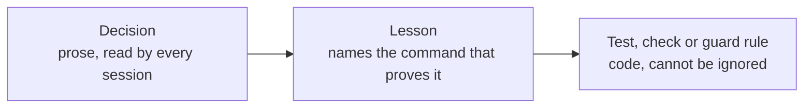

# The loop

Builds the backlog unattended, one item at a time. Each step runs in a fresh headless Claude Code
session. **The script decides when something is done, not the agent.**

```
pick next item (backlog order, dependencies done; held, FIX, ACC and LEARN items first)
 └─ build session (/goal)  → contract first (docs/contracts/<id>.md: every AC + its proof),
                             then branch, code, tests, PR to the base branch, .loop/result.json
 └─ local gate             → the script runs `localGate.commands` on the pushed head.
                             Failing? fix session with the output, before any CI wait
 └─ pre-merge checks       → base is an ancestor (L-01), no edited migrations, no protected or
                             runtime files, coverage thresholds did not drop, the contract names
                             every AC of the item. They need neither CI nor a reviewer, so they
                             come first
 └─ CI and review together → the script waits for CI while the review session runs on the same
                             head (`review.parallelWithCi`). Red CI and review findings go into
                             one fix round. Cancelled with no runner? re-run, never a fix (L-02)
    review session         → independent, read-only: contract, hard rules, drives the app,
                             scores design quality / originality / craft / functionality 1–10;
                             any score < 7 blocks a UI item. Changes? fix session (max 2 rounds).
                             The merge needs CI green **and** the approval, on one commit
 └─ script merges          → squash, --match-head-commit, into the base branch only
 └─ landed check           → merge commit is on origin/<base> and its patch-id equals the
                             reviewed diff. No? HELD
 └─ base CI                → on the merge commit. Red? a FIX item goes first in line.
                             No result? one re-run, then the run stops (a timeout is not a pass).
                             When the landed check proved the merge commit has exactly the tree
                             PR CI passed on, the next item starts meanwhile (`baseCiWait`)
 └─ post-merge steps       → the script applies new migrations with the Supabase CLI and checks
                             the migration list. Not verified? HELD, and the run stops
 └─ milestone complete?    → acceptance on the deployed dev site, after /api/health reports the
                             merged commit and db ok. Failures become ACC items, max 2 rounds
                           → review packet in .loop/reviews/<milestone>.md, once those items
                             are settled. Fixes from the last round are not re-accepted: the
                             packet and OWNER-ACTIONS say so
```

Why each step is there: [../WHY.md](../WHY.md). It is deliberately **sequential**: concurrent
agents sharing one working tree are what broke the setup this loop replaced.

## Core, profile, project

The loop is three things, kept apart:

| | Where | Knows |
| --- | --- | --- |
| **Core** | `loop/run.mjs`, `loop/lib/`, `loop/guard/core.mjs`, `loop/prompts/` | The method: the item engine, the gates, git, the read-only steps. No framework, host or database |
| **Stack profile** | `loop/profiles/<name>/`, named by `profile` in the project config | What this stack is: the check commands, the files CI runs through, the ratchets, the work types, which guard packs and adapters to use, and the stack's words for each step |
| **Project config** | `loop/loop.config.json` | Which profile, and this project's own values: repo, branches, the dev URL, the git author |

Behind the profile's choices sit **adapters** (`loop/adapters/`: the forge, the deploy probe, the
post-merge steps, notifications) and **guard packs** (`loop/guard/packs/`: the rules for one tool
or service). The core only calls their interfaces. Another stack is another profile and app
skeleton; another forge or host is another adapter. The contract: [profiles/README.md](profiles/README.md).

Two profiles ship: `next-supabase-vercel` (the repository as it stands) and `node-cli`
(`node scripts/apply-preset.mjs node-cli`). This page describes the web preset where it has to
name a tool; where the two differ, the profile decides:

| | Web app | Node CLI |
| --- | --- | --- |
| Local gate | `pnpm check` | `npm run check` |
| Work types | `ui` (four design scores), `default` | `command` (help and errors, ergonomics, output, robustness), `default` |
| Milestone acceptance | on the deployed dev site | on the merged base: packed, installed under `.loop/`, used from there |
| Post-merge steps | migrations to the dev database | none |
| Guard packs | `github`, `supabase`, `vercel` | `github`, `npm` |
| Ratchet | coverage thresholds in the Vitest config | `coverage.thresholds.json` |

## Prerequisites (once)

`/setup-loop` checks and writes all of this. By hand:

1. **Node ≥ 22** and **pnpm**. The runner and guard use Node built-ins only, so they work before
   `pnpm install`.
2. **Claude Code**, logged in (`claude` → `/login`). The preflight checks the minimum version. Do
   not set `ANTHROPIC_API_KEY`; the loop removes it from its sessions unless `allowApiKey` is set.
3. **gh** logged in with access to the repo (`gh auth status`).
4. `loop/loop.config.json` filled: repo, branches, dev URL, the one allowed database project, git
   author. `node loop/run.mjs --dry-run` names everything still missing.
5. `DEV_DB_URL` (the dev database URL) in the environment that runs the loop, for the post-merge
   step. Without it, a merge with migrations is held and the step goes to `.loop/OWNER-ACTIONS.md`.
   Only the runner uses it: agent sessions start without it (see [Session environment](#session-environment)).
6. **Branch protection on the base branch**: require a pull request and the CI check, no required
   approvals, no direct or force pushes. The preflight asks GitHub and refuses to start without a
   protection rule or ruleset. If your plan does not offer one for this repository, set
   `guard.requireBranchProtection` to `false`.
7. `pnpm install` and `pnpm exec playwright install chromium`.
8. Keep the machine awake while it runs.

## Run

```sh
git checkout <base>
pnpm loop --dry-run      # preflight, shows the next item, starts no sessions
pnpm loop --once         # one item end to end: watch the first PR go through
pnpm loop                # everything
```

`pnpm loop` is `node loop/run.mjs`. Every run starts with a **smoke test**: one session is told
to run `git add -A --dry-run`, a harmless command the guard refuses. The run continues only if
`.loop/logs/guard.log` shows it blocked, and only if the session's init event lists nothing foreign (plugins, MCP servers or skills
from outside the repo, auto memory).

| Flag | Does |
| --- | --- |
| `--dry-run` | Preflight and the next item. No sessions |
| `--once` | One item, then stop |
| `--item <ID>` | Only this item |
| `--only <milestone>` | Only items of this milestone |
| `--max-iterations <N>` | Stop after N sessions |
| `--max-hours <H>` | Stop after H hours |
| `--status` | Print the state of every item, held items marked **HELD** |
| `--reset <ID>` | Set an item back to todo |
| `--skip <ID>` | Mark an item skipped |
| `--release <ID>` | Release a held item you fixed by hand (see [Holds](#holds)) |

It resumes where it stopped: all state is in `.loop/state.json`. Run it again after a crash or a
reboot and it continues, including an item that was mid-CI or mid-review.

## Watch, stop, review

| What | Where |
| --- | --- |
| Overview | `pnpm loop --status` |
| Live | the console, or `.loop/status.json` |
| History | `.loop/PROGRESS.md` |
| Every session in full | `.loop/logs/NNN-<item>-<phase>.jsonl` |
| Blocked actions | `.loop/logs/guard.log` (time, item, phase, rule, reason) |
| Time and cost per session | `.loop/ledger.jsonl` (item, phase, duration, turns, cost, outcome) |
| **Things only you can do** | `.loop/OWNER-ACTIONS.md` |
| **Milestone "come look"** | `.loop/reviews/<milestone>.md`, with screenshots |
| Final summary | `.loop/REPORT.md` |
| Stop cleanly (finishes the current step) | create `.loop/STOP` (any content); delete it to run again |
| Phone notifications | set `notify.ntfyTopic`, subscribe in the ntfy app |

The loop never pauses at a milestone. Read each packet when it arrives; change the plan between
runs.

## Guardrails

**The guard** (`loop/guard.mjs`) is a fail-closed PreToolUse hook on every loop session: if it
cannot run, the action is refused. The runner starts sessions with a copy of the guard from the
base branch, so a change in the working tree cannot switch a rule off. Its locked
core (`loop/guard/core.mjs`) holds the git, file and read-only rules. The rules for a tool or
service are in guard packs (`loop/guard/packs/`), switched on by `guard.packs` in the profile
(the web preset: `github`, `supabase`, `vercel`; the CLI preset: `github`, `npm`). A pack can only block, an unknown pack name refuses
every call, and the packs are part of the snapshot. Together they block:

| Area | Blocked |
| --- | --- |
| Git | push to base or production, force-push, commits on base, `git add -A`, history-destroying commands |
| Merging | `gh pr merge` (only the script merges), repo settings, secrets, branch protection, `gh api` writes |
| Database | any Supabase project except `guard.allowedDbProject`, every ref in `guard.forbiddenRefs`, `apply_migration`, `supabase db push` / `reset`, writing or destructive SQL from a session |
| SQL | judged with comments removed, the way Postgres reads it, so a comment can neither trip a rule nor hide a write |
| Files | `loop/**` and the other `guard.protectedPaths`, `.env*`, migrations already on base, broad deletes |
| Read-only steps | review, accept and packet: any write outside `.loop/`, any git write. These sessions also start without write tools |
| Hosting | Vercel settings writes |

**After every session** the runner checks what no command pattern can be trusted to catch, and
stops the run (`.loop/STOP`, with an entry in `.loop/OWNER-ACTIONS.md`) if any fails:

| Check | Why |
| --- | --- |
| The guard snapshot and the session settings are byte-for-byte unchanged | a session that edits them would switch the guard off for every later one. Both are rebuilt from the base branch before every session |
| `origin/<base>` and `origin/<production>` did not move | only the runner's own merge moves the base. A push or merge by a session, in whatever spelling, shows up here |
| A read-only session left the tree clean | otherwise the change is counted as a guard violation and kept aside as a stash |

A PR found already merged before the runner merged it is **held** (`outside-merge`) until you
release it; the item is then rebuilt through the gates. Branch protection on the base branch that
requires the CI check stops such a merge at GitHub as well. The preflight checks that the base
branch has one and refuses to start without it.

### Session environment

An agent session does not get the runner's secrets. Removed from every session: each
`postMerge[].dbUrlEnv` (the dev database URL) and every name in `sessionEnvDeny`. The deploy
bypass secret (`deploy.bypassSecretEnv`) reaches only the acceptance and packet steps, which open
the deployed site. The guard's SQL rules cover the database tool; they cannot see a shell command
that connects on its own, so the URL must not be there to use. List any other variable only the
runner or you need in `sessionEnvDeny`. Keep such values out of files a session can read, too.

### The contract and the AC gate

The build session writes `docs/contracts/<item>.md`. The pre-merge check refuses the PR unless
that file names every AC ID the item names (in `refs`, `title` or `scope`). In CI,
`scripts/ac-trace.mjs` then requires each AC a contract names to be in the title of a test that
runs: `skip`, `todo`, `fixme` and expected-to-fail tests do not count. ACs of items not built
yet are listed as pending. `pnpm ac-trace --all` checks every AC, for a release.

### Evidence, not titles

In CI the AC gate reads the JUnit reports the test steps write to `artifacts/junit/`
(`pnpm ac-trace --results artifacts/junit`). An AC a contract names must be named by a test case
that **ran and passed**. A test inside a skipped group, a conditional skip or a file the runner
never collected has a title and no passing case, so it does not count. A missing report fails the
check. Any test runner that writes JUnit can feed it.

### Base CI in the background

`baseCiWait: "unless-tree-equal"` (the default): the landed check compares the merge commit's tree
with the reviewed head. When they are identical, PR CI already passed on exactly that tree, so the
next item starts while base CI runs. Nothing is waived: the runner looks at every pending commit
before each item, a red result queues its FIX item first in line, and a commit without a verdict
(after one re-run) stops the run with an owner action. Before a milestone is accepted and before a
run reports its result, the runner waits for every pending verdict. `"always"` waits after every
merge.

### A red base and the post-merge steps

`postMergeOnRedBase: "apply"` (the default) runs the post-merge steps even when base CI is red
after a merge. That is deliberate: the host deploys the base branch whether CI is green or not, and
merged code without its migration is the outage the hold gate exists for. `"wait"` is for steps
that must never act on a red base (a release, a publish): the item stays open, its FIX item runs
first, and the steps run once that item is done. If the FIX item does not finish, the item is held.

### The local gate

`localGate.commands` (the preset: `pnpm check`) are run by the runner on the pushed branch head
after each build session, with the same reduced environment as a session. A failure goes straight
to a fix session with the output in `.loop/logs/gate-<item>-r<round>.txt` and counts against the
CI fix rounds. It does not replace CI: CI still decides the merge. Set `commands` to `[]` to
switch it off.

**Pre-merge, the runner also refuses** changes to CI's wiring: the `scripts` in `package.json`,
`scripts/`, the lint, test, type and format configs, and any Vitest config change other than
raised threshold numbers. A PR that could switch a gate off must not be able to pass it.

**Session flags.** Every session runs with `--setting-sources project,local`,
`--strict-mcp-config` (plus the repo's `.mcp.json` if there is one), `--permission-mode auto`,
`--permission-prompts none` and `--max-budget-usd`. Never `--bare`, because it skips hooks. Never
bypass permissions. Generated settings turn auto memory off.

**Budgets** (all in `loop/loop.config.json`):

| Limit | Default |
| --- | --- |
| Sessions per run | 150 |
| Hours per run | 120 |
| Dollars per session | 25 |
| Dollars per run (`budgets.maxUsdPerRun`) | 0 = no cap |
| Failed attempts per item | 3 |
| Build rounds per item, fixes included | 8 |
| CI fix rounds per item | 3 |
| Review rounds per item | 2 |
| Acceptance rounds per milestone | 2 |
| **Circuit breaker**: items in a row with no merge | 3 |

**One loop at a time**: a lock file refuses a second instance.
**Usage limits**: the loop sleeps until the reset and retries the same step; the session is not
counted. **Destructive migrations** (`DROP`, `TRUNCATE`, unbounded `DELETE`) are never applied
automatically; they go to `.loop/OWNER-ACTIONS.md`. **The production branch is never touched.**

## Holds

A merged item is **held**, not done, when the script cannot prove the merge is safe. The run
stops, `--status` says **HELD**, `REPORT.md` lists it and `.loop/OWNER-ACTIONS.md` says what to do.
A resumed run takes the held item before any other, whatever `--item` or `--only` say, and checks
again.

| Hold | Cause | Release |
| --- | --- | --- |
| Landed check | The merge commit is not on `origin/<base>`, or its patch differs from the reviewed diff | Find out what landed (`git log origin/<base>`), fix it with a normal PR, then `--release <ID>` |
| Base CI | No CI result on the merge commit, even after one re-run | Get CI running (runners, billing), then re-run: the loop checks again |
| Post-merge | Migrations not applied or not verified: CLI error, `DEV_DB_URL` missing, a destructive file | Fix the cause and re-run: the loop applies and verifies again. For a file you applied yourself (a destructive one), run `--release <ID>` after checking `supabase migration list` |

Delete `.loop/STOP` if there is one before you re-run.

## Learning and the tighten-only rule table

The script counts repeated failures by signature: the same review finding
(`review:<category>:<cause>`), the same guard rule (`guard:<rule id>`), the same CI job
(`ci:<job name>`), the same local gate command (`gate:<command>`). The second time
(`learnThreshold`), it queues a `LEARN-n` item first in line.

The reviewer gives each blocking finding a category and a short cause key, and is shown the keys the
run already uses so the same cause gets the same key. Findings that share only the category
(`review:<category>`, different causes) need `learnCategoryThreshold` (4) before they count as a
pattern: two unrelated bugs in fifty items are not one, and a LEARN item costs a whole build cycle. That item fixes the
cause, one step up this ladder:



Acceptance failures become `ACC-*` items, whose scope includes fixing the cause.

Project guard rules live in `loop/rules/project-rules.json`. The loop may only **add** rows:

| Field | Meaning |
| --- | --- |
| `id` | Unique, never reused |
| `target` | `shell` (the command line), `path` (the file an edit writes), `sql` (an `execute_sql` query, comments removed), `mcp` (`<tool> <json input>`) |
| `pattern`, `flags` | The regex that blocks. Flags default to `i` |
| `phases` | Optional: only in these phases |
| `reason` | What the agent is told when blocked |
| `examples.block` / `examples.allow` | One text the rule must block, one it must allow |

`loop/scripts/check-rules.mjs` runs in CI and fails when a row from the base branch is removed or
changed, when an id repeats, when a regex does not compile, or when a rule does not block its block
example or does block its allow example.

## Runner patches

Agents cannot edit `loop/**`. A change the loop wants in the runner itself is written as a **new**
file `loop/patches/<id>.patch`, with a short reason at the top. The run continues without it.
After the run, `/run-retro` reviews and applies pending patches (`git apply loop/patches/<id>.patch`),
then runs `pnpm test:loop`.

## Changing the plan

`loop/backlog.json` holds the items and their order; `docs/REQUIREMENTS.md` stays the source of
truth for acceptance criteria. Edit the backlog between runs: reorder, add or split items. Agents
cannot edit it. `loop/loop.config.json` overrides any default in `loop/lib/config.mjs`.

## Taking a later template version

A project made from the template is a copy. `scripts/sync-template.mjs` brings the template's
part of it up to date:

```sh
node scripts/sync-template.mjs --dry-run
node scripts/sync-template.mjs
```

Without `--from` it syncs from the template the repository was created from (it asks GitHub
through `gh`). `--from <folder or git URL>` names another source, `--ref <branch>` a branch of a
URL. A project that does not have the command yet runs the template's copy from its own folder:
`node ../real-gates/scripts/sync-template.mjs`.

| | Paths | What happens |
| --- | --- | --- |
| The template's | `loop/`, `.claude/skills/`, the shared scripts, `loop-runner.yml`, the CI workflow of your stack | replaced; a file the template dropped is removed |
| Yours, inside `loop/` | `loop.config.json`, `backlog.json`, `rules/project-rules.json`, `patches/` | never touched |
| Yours | docs, `CLAUDE.md`, the app, `package.json` | never touched; when the template changed one since your last sync, the command names it |

The list lives in `loop/harness.json`. The command refuses a working tree with uncommitted
changes, and records the template commit it synced from in `loop/template.lock.json`.

Do it between runs, never while the loop runs: sessions start with the guard from the base
branch. Afterwards run `node loop/run.mjs --dry-run` and the runner suite, commit on a branch and
merge it through a pull request like any other change. A new template version can add a config
key or a preflight check; the dry run names what it needs.

## Tests

`pnpm test:loop` runs the runner suite: a fake `claude` and a fake `gh` play scripted sessions
through every branch (red CI, review changes, held post-merge, usage limit, crash and resume),
in a few minutes and without tokens. CI runs it on Linux, macOS and Windows.
