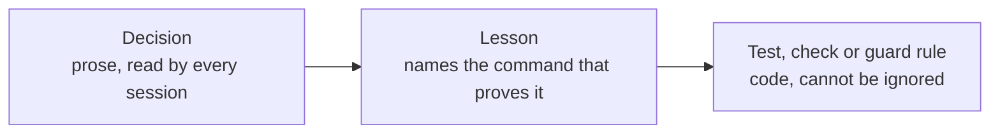

# The loop

Builds the backlog unattended, one item at a time. Each step runs in a fresh headless Claude Code
session. **The script decides when something is done, not the agent.**

```
pick next item (backlog order, dependencies done; held, FIX, ACC and LEARN items first)
 └─ build session (/goal)  → contract first (docs/contracts/<id>.md: every AC + its proof),
                             then branch, code, tests, PR to the base branch, .loop/result.json
 └─ script waits for CI    → red? fix session with the failing log
                             cancelled with no runner? re-run, never a fix (L-02)
 └─ pre-merge checks       → base is an ancestor (L-01), no edited migrations, no protected or
                             runtime files, coverage thresholds did not drop
 └─ review session         → independent, read-only: contract, hard rules, drives the app,
                             scores design quality / originality / craft / functionality 1–10;
                             any score < 7 blocks a UI item. Changes? fix session (max 2 rounds)
 └─ script merges          → squash, --match-head-commit, into the base branch only
 └─ landed check           → merge commit is on origin/<base> and its patch-id equals the
                             reviewed diff. No? HELD
 └─ base CI                → on the merge commit. Red? a FIX item goes first in line.
                             No result? one re-run, then HELD (a timeout is not a pass)
 └─ post-merge steps       → the script applies new migrations with the Supabase CLI and checks
                             the migration list. Not verified? HELD, and the run stops
 └─ milestone complete?    → acceptance on the deployed dev site, after /api/health reports the
                             merged commit and db ok. Failures become ACC items, max 2 rounds
                           → review packet in .loop/reviews/<milestone>.md
```

Why each step is there: [../WHY.md](../WHY.md). It is deliberately **sequential**: concurrent
agents sharing one working tree are what broke the setup this loop replaced.

## Prerequisites (once)

`/setup-loop` checks and writes all of this. By hand:

1. **Node ≥ 22** and **pnpm**. The runner and guard use Node built-ins only, so they work before
   `pnpm install`.
2. **Claude Code**, logged in (`claude` → `/login`). The preflight checks the minimum version. Do
   not set `ANTHROPIC_API_KEY`; the loop removes it from its sessions unless `allowApiKey` is set.
3. **gh** logged in with access to the repo (`gh auth status`).
4. `loop/loop.config.json` filled: repo, branches, dev URL, the one allowed database project, git
   author. `node loop/run.mjs --dry-run` names everything still missing.
5. `DEV_DB_URL` (the dev database URL) in the environment that runs the loop, for the post-merge
   step. Without it, a merge with migrations is held and the step goes to `.loop/OWNER-ACTIONS.md`.
6. `pnpm install` and `pnpm exec playwright install chromium`.
7. Keep the machine awake while it runs.

## Run

```sh
git checkout <base>
pnpm loop --dry-run      # preflight, shows the next item, starts no sessions
pnpm loop --once         # one item end to end: watch the first PR go through
pnpm loop                # everything
```

`pnpm loop` is `node loop/run.mjs`. Every run starts with a **smoke test**: one session is told
to run `git add -A --dry-run`, a harmless command the guard refuses. The run continues only if
`.loop/logs/guard.log` shows it blocked, and only if the session's init event lists nothing foreign (plugins, MCP servers or skills
from outside the repo, auto memory).

| Flag | Does |
| --- | --- |
| `--dry-run` | Preflight and the next item. No sessions |
| `--once` | One item, then stop |
| `--item <ID>` | Only this item |
| `--only <milestone>` | Only items of this milestone |
| `--max-iterations <N>` | Stop after N sessions |
| `--max-hours <H>` | Stop after H hours |
| `--status` | Print the state of every item, held items marked **HELD** |
| `--reset <ID>` | Set an item back to todo |
| `--skip <ID>` | Mark an item skipped |
| `--release <ID>` | Release a held item you fixed by hand (see [Holds](#holds)) |

It resumes where it stopped: all state is in `.loop/state.json`. Run it again after a crash or a
reboot and it continues, including an item that was mid-CI or mid-review.

## Watch, stop, review

| What | Where |
| --- | --- |
| Overview | `pnpm loop --status` |
| Live | the console, or `.loop/status.json` |
| History | `.loop/PROGRESS.md` |
| Every session in full | `.loop/logs/NNN-<item>-<phase>.jsonl` |
| Blocked actions | `.loop/logs/guard.log` (time, item, phase, rule, reason) |
| **Things only you can do** | `.loop/OWNER-ACTIONS.md` |
| **Milestone "come look"** | `.loop/reviews/<milestone>.md`, with screenshots |
| Final summary | `.loop/REPORT.md` |
| Stop cleanly (finishes the current step) | create `.loop/STOP` (any content); delete it to run again |
| Phone notifications | set `notify.ntfyTopic`, subscribe in the ntfy app |

The loop never pauses at a milestone. Read each packet when it arrives; change the plan between
runs.

## Guardrails

**The guard** (`loop/guard.mjs`) is a fail-closed PreToolUse hook on every loop session: if it
cannot run, the action is refused. The runner starts sessions with a copy of the guard from the
base branch, so a change in the working tree cannot switch a rule off. Its locked core
(`loop/guard/core.mjs`) blocks:

| Area | Blocked |
| --- | --- |
| Git | push to base or production, force-push, commits on base, `git add -A`, history-destroying commands |
| Merging | `gh pr merge` (only the script merges), repo settings, secrets, branch protection, `gh api` writes |
| Database | any Supabase project except `guard.allowedDbProject`, every ref in `guard.forbiddenRefs`, `apply_migration`, `supabase db push` / `reset`, writing or destructive SQL from a session |
| SQL | judged with comments removed, the way Postgres reads it, so a comment can neither trip a rule nor hide a write |
| Files | `loop/**` and the other `guard.protectedPaths`, `.env*`, migrations already on base, broad deletes |
| Read-only steps | review, accept and packet: any write outside `.loop/`, any git write. These sessions also start without write tools |
| Hosting | Vercel settings writes |

**Session flags.** Every session runs with `--setting-sources project,local`,
`--strict-mcp-config` (plus the repo's `.mcp.json` if there is one), `--permission-mode auto`,
`--permission-prompts none` and `--max-budget-usd`. Never `--bare`, because it skips hooks. Never
bypass permissions. Generated settings turn auto memory off.

**Budgets** (all in `loop/loop.config.json`):

| Limit | Default |
| --- | --- |
| Sessions per run | 150 |
| Hours per run | 120 |
| Dollars per session | 25 |
| Failed attempts per item | 3 |
| Build rounds per item, fixes included | 8 |
| CI fix rounds per item | 3 |
| Review rounds per item | 2 |
| Acceptance rounds per milestone | 2 |
| **Circuit breaker**: items in a row with no merge | 3 |

**One loop at a time**: a lock file refuses a second instance.
**Usage limits**: the loop sleeps until the reset and retries the same step; the session is not
counted. **Destructive migrations** (`DROP`, `TRUNCATE`, unbounded `DELETE`) are never applied
automatically; they go to `.loop/OWNER-ACTIONS.md`. **The production branch is never touched.**

## Holds

A merged item is **held**, not done, when the script cannot prove the merge is safe. The run
stops, `--status` says **HELD**, `REPORT.md` lists it and `.loop/OWNER-ACTIONS.md` says what to do.
A resumed run takes the held item before any other, whatever `--item` or `--only` say, and checks
again.

| Hold | Cause | Release |
| --- | --- | --- |
| Landed check | The merge commit is not on `origin/<base>`, or its patch differs from the reviewed diff | Find out what landed (`git log origin/<base>`), fix it with a normal PR, then `--release <ID>` |
| Base CI | No CI result on the merge commit, even after one re-run | Get CI running (runners, billing), then re-run: the loop checks again |
| Post-merge | Migrations not applied or not verified: CLI error, `DEV_DB_URL` missing, a destructive file | Fix the cause and re-run: the loop applies and verifies again. For a file you applied yourself (a destructive one), run `--release <ID>` after checking `supabase migration list` |

Delete `.loop/STOP` if there is one before you re-run.

## Learning and the tighten-only rule table

The script counts repeated failures by signature: the same kind of review finding
(`review:<category>`), the same guard rule (`guard:<rule id>`), the same CI job
(`ci:<job name>`). The second time, it queues a `LEARN-n` item first in line. That item fixes the
cause, one step up this ladder:



Acceptance failures become `ACC-*` items, whose scope includes fixing the cause.

Project guard rules live in `loop/rules/project-rules.json`. The loop may only **add** rows:

| Field | Meaning |
| --- | --- |
| `id` | Unique, never reused |
| `target` | `shell` (the command line), `path` (the file an edit writes), `sql` (an `execute_sql` query, comments removed), `mcp` (`<tool> <json input>`) |
| `pattern`, `flags` | The regex that blocks. Flags default to `i` |
| `phases` | Optional: only in these phases |
| `reason` | What the agent is told when blocked |
| `examples.block` / `examples.allow` | One text the rule must block, one it must allow |

`loop/scripts/check-rules.mjs` runs in CI and fails when a row from the base branch is removed or
changed, when an id repeats, when a regex does not compile, or when a rule does not block its block
example or does block its allow example.

## Runner patches

Agents cannot edit `loop/**`. A change the loop wants in the runner itself is written as a **new**
file `loop/patches/<id>.patch`, with a short reason at the top. The run continues without it.
After the run, `/run-retro` reviews and applies pending patches (`git apply loop/patches/<id>.patch`),
then runs `pnpm test:loop`.

## Changing the plan

`loop/backlog.json` holds the items and their order; `docs/REQUIREMENTS.md` stays the source of
truth for acceptance criteria. Edit the backlog between runs: reorder, add or split items. Agents
cannot edit it. `loop/loop.config.json` overrides any default in `loop/lib/config.mjs`.

## Tests

`pnpm test:loop` runs the runner suite: a fake `claude` and a fake `gh` play scripted sessions
through every branch (red CI, review changes, held post-merge, usage limit, crash and resume),
in a few minutes and without tokens. CI runs it on Linux, macOS and Windows.
