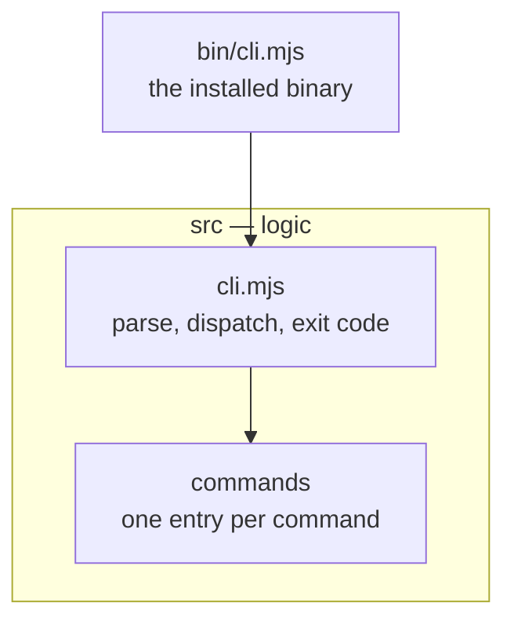

# 5 · Building blocks

<!-- The module map. Start from the folder tree (`git ls-files bin src | sort`), then check it by
     hand. A new command or module updates this page in the same PR. -->

| Block              | Path          | Responsibility                                          | Depends on |
| ------------------ | ------------- | ------------------------------------------------------- | ---------- |
| Binary             | `bin/cli.mjs` | Hands the arguments to `main` and sets the exit code    | Dispatch   |
| Dispatch           | `src/cli.mjs` | Picks the command, prints help and version, maps errors | —          |
| <!-- new block --> |               |                                                         |            |
